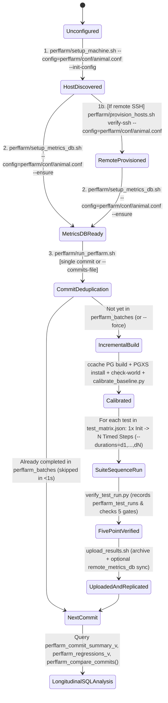

# Agent-Oriented Guide: Perffarm Animal Setup, Execution & Regression Analysis

**Target Audience**: Autonomous AI coding/benchmarking agents, CI/CD runners, and database engineers operating **`perffarm/`** in `postsql/pgbench4perffarm`.  
**Companion Skill**: [`skills/pgbench4perffarm/SKILL.md`](../skills/pgbench4perffarm/SKILL.md)  
**Main `pgbench` Companion Guide**: [`doc/agent-guide-pgbench.md`](agent-guide-pgbench.md)  
**Human Operational Guide**: [`doc/perffarm-guide.md`](perffarm-guide.md)

---

## 1. Perffarm Autonomous Agent State Machine

`perffarm/` is a zero-external-dependency Bash + Python 3 orchestration harness designed so an AI agent or cron runner can provision a benchmarking "animal", compile PostgreSQL commits from source, execute multi-duration benchmark sequences, verify 5-point run integrity, and query longitudinal SQL regression views.



---

## 2. Intent-to-Command Dispatch Matrix for Perffarm Operations

| Agent / User Objective | Exact Command to Execute | Expected Output / Verification |
| :--- | :--- | :--- |
| **1. First-time machine discovery & config generation** | `ANIMAL_NAME=my_animal WORKDIR=/var/tmp/perffarm ./perffarm/setup_machine.sh --config=perffarm/conf/animal.conf --init-config` | Writes `perffarm/conf/animal.conf`, `$STATE_DIR/server_instance_info.json`, `$STATE_DIR/client_instance_info.json`, `$STATE_DIR/hardware_profile.json`, and `$STATE_DIR/postgresql.animal.conf`. |
| **2. Verify / provision remote SSH server & client hosts** | `./perffarm/provision_hosts.sh verify-ssh --config=perffarm/conf/animal.conf` *(or `provision` / `sync-repo` / `status`)* | Verifies passwordless `ssh -o BatchMode=yes`, provisions remote `WORKDIR` / packages, syncs repo, and checks host status. |
| **3. Bootstrap isolated persistent Metrics DB** | `./perffarm/setup_metrics_db.sh --config=perffarm/conf/animal.conf --ensure` | Uses/copies isolated `$WORKDIR/metrics_pg_install` (or `--pg-config=PATH`), starts `perffarm_metrics` on port `55433`, applies `perffarm/sql/metrics_db_schema.sql`, and upserts `perffarm_animals`. |
| **4. Check Metrics DB health & row counts** | `./perffarm/setup_metrics_db.sh --config=perffarm/conf/animal.conf --status` | Prints `pg_isready` status and row counts for `perffarm_animals`, `perffarm_batches`, `perffarm_test_runs`, and `pgbench_runs`. |
| **5. Fast smoke verification (`<= 60s`) using pre-built PG** | `./perffarm/run_perffarm.sh --config=perffarm/conf/animal.conf --prebuilt-pg-config=/path/to/pg_config --profile=smoke --tests=tpcb-like,pgbench-b,pgbench-c --durations=2,2 --fast-check --force` | Runs 2x2s sequence on 3 tests, passes 5-point `verify_test_run.py`, and records rows in `perffarm_batches` and `perffarm_test_runs` (`verification_status = 'PASSED'`). |
| **6. Standard multi-duration sequence on a single prepared DB (`3x60s` warmup + `1x300s` steady-state)** | `./perffarm/run_perffarm.sh --config=perffarm/conf/animal.conf --profile=standard --tests=pgbench-c --durations=60,60,60,300 --force` | Initializes `pgbench-c` once, runs 4 timed steps (`r1..r4`) without re-initializing, and logs all 4 runs to `perffarm_metrics`. |
| **7. Historical multi-commit sweep (`1 commit/24h` over last 31 or 90 days)** | `./perffarm/run_perffarm.sh --config=perffarm/conf/animal.conf --branch=master --commits-file=perffarm/conf/commits_master_24h_last_month.txt --ci-status=github_success --profile=standard --tests=pgbench-c --durations=60,60,60,300 --fast-check` | Iterates oldest->newest, skips already-completed commits before building, uses `ccache` + `.perffarm_cfg_sig`, and populates `perffarm_commit_summary_v`. |
| **8. Sync / backfill a batch to `REMOTE_METRICS_DB_CONNINFO`** | `./perffarm/upload_results.sh --config=perffarm/conf/animal.conf --batch-dir="$WORKDIR/results/batch_<id>_..." [--batch-id=<id>]` | Archives the batch (auto-detecting `batch_id` from `batch_manifest.json` if `--batch-id` is omitted) and replicates `perffarm_animals`, `perffarm_batches`, `pgbench_runs` (with child tables), and `perffarm_test_runs` to `REMOTE_METRICS_DB_CONNINFO` collision-safely. |

---

## 3. Architectural Invariants of `perffarm/`

### 3.0 Always Initialize `animal.conf` via `--init-config` (or `cp animal.conf.example`)
All `perffarm/*.sh` scripts execute under `set -euo pipefail`. Never write a partial `animal.conf` containing only a few variables, or `setup_machine.sh` / `run_perffarm.sh` will fail with `unbound variable` (e.g., `PG_CONF_FILE: unbound variable`). Always create `animal.conf` using `./perffarm/setup_machine.sh --config=perffarm/conf/animal.conf --init-config` (which copies `perffarm/conf/animal.conf.example` containing `${VAR:-default}` fallbacks for every setting) and override individual settings via environment variables or edits.

### 3.1 Isolated `metrics_pg_install` vs. Ephemeral SUT `install`
During a multi-commit sweep (`--commits-file`), `run_perffarm.sh` repeatedly compiles and installs different PostgreSQL commits into `$WORKDIR/install`.
- **Invariant**: `setup_metrics_db.sh` resolves a stable `pg_config` (or copies `$WORKDIR/install` into an immutable **`$WORKDIR/metrics_pg_install`**) for the persistent `perffarm_metrics` cluster (`$WORKDIR/metrics_pgdata`).
- **Why**: This guarantees that `make install` of an older PostgreSQL commit across `CATALOG_VERSION_NO` boundaries into `$WORKDIR/install` never overwrites the running `postgres` binary or `libpq.so` of `perffarm_metrics`.

### 3.2 Fast Incremental Multi-Commit Builds (`USE_CCACHE` + `.perffarm_cfg_sig`)
When sweeping 30–90 historical commits:
1. **Pre-Build Deduplication**: Before compiling a commit, `run_perffarm.sh` queries `perffarm_batches` in `METRICS_DB_CONNINFO` for `(animal_name, pg_branch, git_commit_sha, test_profile)` with `status = 'completed'`. Matching commits are skipped in `< 0.5s` unless `--force` is passed.
2. **Configuration Signature Caching (`.perffarm_cfg_sig`)**: `run_perffarm.sh` hashes `(CONFIGURE_FLAGS, CC, CFLAGS, md5(configure.ac))` into `$BUILD_DIR/.perffarm_cfg_sig`. When consecutive commits share the same `configure.ac` signature, `run_perffarm.sh` skips `./configure` and `make clean`, running incremental `make -j$(nproc)` backed by `ccache` (~15–25s per commit instead of ~2 minutes).

### 3.3 Multi-Duration Sequences on a Single Prepared Database (`--durations`)
Passing `--durations=60,60,60,300` (or `60x3,300` or `--repeats=3`) executes the following sequence for each selected test in `conf/test_matrix.json`:
1. **Initialize once** (or clone from cached template DB if `REUSE_TEMPLATE_DB=true`).
2. **Execute `N` sequential timed runs against that same prepared database without re-initializing**:
   - Run 1 (`60s`): `sequence_run_index = 1`, `sequence_total_runs = 4`, `target_duration_sec = 60`, `prepared_db_reused = false`.
   - Runs 2–3 (`60s`): `sequence_run_index = 2..3`, `target_duration_sec = 60`, `prepared_db_reused = true` (measures run-to-run variance on warmed buffers/WAL).
   - Run 4 (`300s`): `sequence_run_index = 4`, `target_duration_sec = 300`, `prepared_db_reused = true` (measures steady-state sustained throughput and tail latency).

### 3.4 Baseline Calibration Probe (`calibrate_baseline.py`)
Before running the test matrix on a commit, `run_perffarm.sh` runs `perffarm/calibrate_baseline.py` to measure:
1. **`SELECT 1;`**: Client-to-server round-trip latency (`select1_avg_ms`) and single-connection QPS (`select1_qps`).
2. **`SELECT repeat('0123456789', 100000);`**: Client-to-server 1 MB payload transfer latency (`repeat1mb_avg_ms`) and bandwidth (`repeat1mb_mb_per_sec`).
- **Agent Rule**: If a commit shows a throughput drop, inspect `select1_avg_ms` and `repeat1mb_mb_per_sec` in `perffarm_commit_summary_v` first to separate host/network noise from database engine regressions.

---

## 4. The 5-Point Verification Contract (`perffarm/verify_test_run.py`)

Every test run is validated by `perffarm/verify_test_run.py` against 5 gates and recorded in `perffarm_test_runs` (`verification_status = 'PASSED'` or `'FAILED'`):

| Gate | JSON Key in `verification_details.checks` | Pass Criteria | What to Inspect When `false` |
| :--- | :--- | :--- | :--- |
| **1. Exit Code Zero** | `1_exit_code_zero` | `pgbench` `exit_code == 0` and `--json-report` is non-empty valid JSON. | `$TEST_DIR/pgbench_run*.log` and `test_result_bundle.json`. |
| **2. Transactions Healthy** | `2_transactions_healthy` | `transactions > 0` and unexpected `failed_transactions == 0` (expected rollbacks inside `\try`/`\catch` are tracked separately in `expected_rollbacks`). | `$TEST_DIR/pgbench_report*.json` (`$.overall`). |
| **3. Result Validation 100%** | `3_result_validation_100pct` | `validation_failed == 0` across all `\validate_result` checks. | `$TEST_DIR/pgbench_report*.json` (`$.overall.validation_failed`). |
| **4. SLA Compliance** | `4_sla_compliance` | `sla_all_passed == true` across all `--sla` rules. | `checks.4_sla_compliance.sla_verifications` in `$TEST_DIR/test_result_bundle.json`. |
| **5. Server Log Clean** | `5_server_log_clean` | PostgreSQL server log has zero `PANIC:`, `TRAP:`, `FailedAssertion`, `Segmentation fault`, unexpected `FATAL:`, `cache reference leak`, `buffer refcount leak`, `TupleDesc reference leak`, `Snapshot reference leak`, or `relcache reference leak`. | `checks.5_server_log_clean.severe_error_lines` and `$LOG_DIR/postgres_*.log`. |

---

## 5. Longitudinal SQL Regression Analysis Cookbook (`perffarm_metrics`)

Connect to `METRICS_DB_CONNINFO` (default `host=127.0.0.1 port=55433 dbname=perffarm_metrics`) using `psql` to run longitudinal analysis across commits and animals.

### 5.1 View Schema & Partitioning Rules
`perffarm/sql/metrics_db_schema.sql` defines two longitudinal views and one commit-comparison SRF:
1. **`perffarm_commit_summary_v`**:
   - Joins `perffarm_test_runs`, `perffarm_batches`, `perffarm_animals`, and `pgbench_runs`.
   - Exposes `test_run_id`, `batch_id`, `animal_name`, `topology`, `test_profile`, `pg_branch`, `commit_short`, `git_commit_sha`, `git_commit_ts`, `git_commit_subject`, `test_name`, `suite_name`, `verification_status`, `tps`, `latency_avg_ms`, `latency_p50_ms`, `latency_p95_ms`, `latency_p99_ms`, `recall_avg`, `server_cpus`, `server_ram_gb`, `server_sys_disk_media`, `server_data_disk_media`, `server_wal_disk_media`, `select1_avg_ms`, `select1_qps`, `repeat1mb_mb_per_sec`, `buffer_hit_ratio_pct`, `wal_bytes_generated`, `server_cpu_busy_pct`, `run_seq_idx`, `run_seq_total`, `target_duration_sec`, `prepared_db_reused`, `run_label`.
2. **`perffarm_regressions_v`**:
   - Computes `LAG()` window functions (`prev_commit_short`, `prev_tps`, `tps_pct_change`, `prev_latency_p95_ms`, `latency_p95_pct_change`, `prev_recall_avg`) partitioned strictly by **`(animal_name, pg_branch, test_profile, test_name, run_seq_idx, target_duration_sec)`** and ordered chronologically by `COALESCE(git_commit_ts, started_at) ASC, batch_id ASC, test_run_id ASC`.
   - Assigns `verdict`: `'FAILED_VERIFICATION'`, `'REGRESSED'` (TPS drop `< -5.0%` or P95 latency increase `> +10.0%`), `'IMPROVED'` (TPS gain `> +5.0%`), or `'STABLE'`.
3. **`perffarm_compare_commits(p_sha_a, p_sha_b, p_animal DEFAULT NULL, p_suite_filter DEFAULT NULL)`**:
   - Selects the latest batch for `p_sha_a` and `p_sha_b` (prefix match supported) per `(animal_name, test_name)` and pairs matching `(run_seq_idx, target_duration_sec)` steps across 8 core metrics (`tps`, `latency_avg_ms`, `latency_p50_ms`, `latency_p95_ms`, `latency_p99_ms`, `select1_avg_ms`, `repeat1mb_mb_per_sec`, `recall_avg`).
   - Returns: `(animal_name, test_name, suite_name, metric, unit, sha_a_val, sha_b_val, abs_delta, pct_change, verdict)`.

### 5.2 Essential Agent SQL Queries

```sql
-- Query 1: Commit-over-commit trend for steady-state step 4 (300s) of pgbench-c
SELECT
    git_commit_ts::date AS date,
    commit_short AS sha,
    left(git_commit_subject, 48) AS subject,
    tps,
    latency_p50_ms AS p50_ms,
    latency_p95_ms AS p95_ms,
    latency_p99_ms AS p99_ms,
    buffer_hit_ratio_pct AS hit_pct,
    server_cpu_busy_pct AS cpu_pct,
    verification_status
FROM perffarm_commit_summary_v
WHERE test_name = 'pgbench-c'
  AND run_seq_idx = 4
  AND target_duration_sec = 300
ORDER BY git_commit_ts DESC;

-- Query 2: Check warm-up convergence across steps 1..3 (60s) vs step 4 (300s) for every commit
SELECT
    commit_short AS sha,
    git_commit_ts::date AS date,
    MAX(CASE WHEN run_seq_idx = 1 THEN tps END) AS r1_60s_tps,
    MAX(CASE WHEN run_seq_idx = 2 THEN tps END) AS r2_60s_tps,
    MAX(CASE WHEN run_seq_idx = 3 THEN tps END) AS r3_60s_tps,
    round(
      (MAX(CASE WHEN run_seq_idx IN (1,2,3) THEN tps END) -
       MIN(CASE WHEN run_seq_idx IN (1,2,3) THEN tps END)) * 100.0 /
      NULLIF(AVG(CASE WHEN run_seq_idx IN (1,2,3) THEN tps END), 0), 2
    ) AS warmup_spread_pct,
    MAX(CASE WHEN run_seq_idx = 4 THEN tps END) AS r4_300s_tps
FROM perffarm_commit_summary_v
WHERE test_name = 'pgbench-c'
GROUP BY commit_short, git_commit_ts
ORDER BY git_commit_ts DESC;

-- Query 3: Surface all detected regressions or improvements across commit history
SELECT animal_name, test_name, run_seq_idx, target_duration_sec,
       prev_commit_short, commit_short,
       prev_tps, tps, tps_pct_change,
       prev_latency_p95_ms, latency_p95_ms, latency_p95_pct_change,
       verdict
FROM perffarm_regressions_v
WHERE verdict <> 'STABLE'
ORDER BY batch_id DESC, run_seq_idx ASC;

-- Query 4: Direct side-by-side comparison between two commit SHAs across all steps
SELECT test_name, metric, unit, sha_a_val, sha_b_val, abs_delta, pct_change, verdict
FROM perffarm_compare_commits('2c10c2ce4d', 'dfd7ede529', 'lynx-x86-nvme', 'pgbench-c');
```

---

## 6. Cross-Animal Central Metrics DB Replication (`REMOTE_METRICS_DB_CONNINFO`)

When multiple Perffarm animals push telemetry to a shared central PostgreSQL database:
1. Set `UPLOAD_TARGETS="metrics_db,archive,remote_metrics_db"` and `REMOTE_METRICS_DB_CONNINFO="host=<central-host> port=55433 dbname=perffarm_metrics"` in each animal's `perffarm/conf/animal.conf`.
2. At the end of every batch, `perffarm/upload_results.sh` automatically:
   - Acquires transaction-scoped advisory lock `pg_advisory_xact_lock(73733476)` on the remote database.
   - Advances `pgbench_runs_run_id_seq` to `GREATEST(curr_seq, MAX(run_id))` so sequences never collide across animals.
   - Replicates `perffarm_animals`, `perffarm_batches`, `pgbench_runs` (with child tables), and `perffarm_test_runs` with collision-free remapped IDs.

---

## 7. Copy-Pasteable Prompt Templates for Directing Agents on Perffarm Tasks

### Template 1: Provision a New Perffarm Animal & Run Fast Smoke Verification
> **Task**: Set up a Perffarm benchmarking animal named `<ANIMAL_NAME>` in `<WORKDIR>` and run a fast smoke verification across `tpcb-like`, `pgbench-b`, and `pgbench-c`.  
> **Instructions**:  
> 1. Read `AGENTS.md` and `doc/agent-guide-perffarm.md`.  
> 2. Run `ANIMAL_NAME=<ANIMAL_NAME> WORKDIR=<WORKDIR> ./perffarm/setup_machine.sh --config=perffarm/conf/animal.conf --init-config`.  
> 3. Bootstrap the isolated Metrics DB via `./perffarm/setup_metrics_db.sh --config=perffarm/conf/animal.conf --ensure`.  
> 4. Run `./perffarm/run_perffarm.sh --config=perffarm/conf/animal.conf --prebuilt-pg-config=<PG_CONFIG> --profile=smoke --tests=tpcb-like,pgbench-b,pgbench-c --durations=2,2 --fast-check --force`.  
> 5. Confirm all test runs recorded `verification_status = 'PASSED'` and query `SELECT * FROM perffarm_commit_summary_v;` from `METRICS_DB_CONNINFO`.

### Template 2: Execute a Multi-Commit Historical Regression Sweep
> **Task**: Run a historical commit sweep across `perffarm/conf/commits_master_24h_last_month.txt` on `<TEST_NAME>` using `--durations=60,60,60,300` and produce a longitudinal regression report.  
> **Instructions**:  
> 1. Read `doc/agent-guide-perffarm.md`.  
> 2. Verify `perffarm_metrics` is running via `./perffarm/setup_metrics_db.sh --config=perffarm/conf/animal.conf --status`.  
> 3. Execute `./perffarm/run_perffarm.sh --config=perffarm/conf/animal.conf --branch=master --commits-file=perffarm/conf/commits_master_24h_last_month.txt --ci-status=github_success --profile=standard --tests=<TEST_NAME> --durations=60,60,60,300 --fast-check`.  
> 4. Query `perffarm_commit_summary_v` and `perffarm_regressions_v`, and for any commit flagged with `verdict = 'REGRESSED'`, run `SELECT * FROM perffarm_compare_commits('<prev_sha>', '<regressed_sha>');`.
