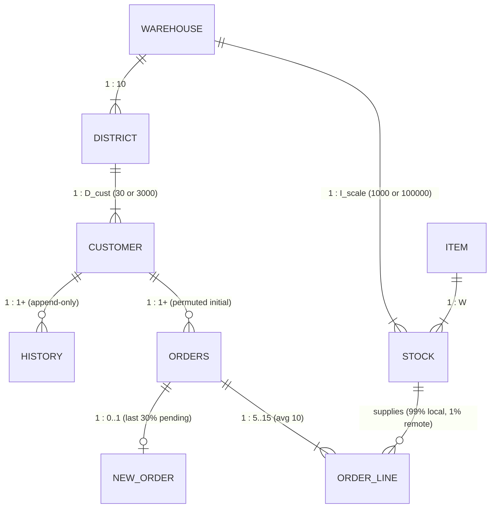

<!--
  DISCLAIMER & INSPIRATION NOTE:
  The pgbench-order (pgbench-c) wholesale order-entry workload is an independent,
  clean-room engineering benchmark inspired by TPC-C concepts. It is NOT an
  official industry standard benchmark, has NOT been audited or certified by any
  standards council, and does NOT produce certified ratings.
  Per our trademark guidelines (src/bin/pgbench/workloads/README and
  src/bin/pgbench/workloads/BENCHMARK_INSPIRATION.md), do not use council
  trademarked names or metrics when referring to this benchmark; everywhere in
  prose, headings, and scripts, use pgbench-order (or pgbench-c) and standard
  engineering metrics (TPS, QPM, orders/sec, ops/sec, and HDR latency
  percentiles).
-->
# Agent-Oriented Specification & Re-Creation Guide: Wholesale Order-Entry Workload (`pgbench-order` / `pgbench-c`)

**Target Audience**: Autonomous AI coding/benchmarking agents and database engineers tasked with re-creating, porting, or adapting the wholesale order-entry workload (`pgbench-order` / `pgbench-c`) to a **new SQL dialect** (e.g., Cloud Spanner GoogleSQL, MySQL/MariaDB, SQLite, DuckDB/Quack, CockroachDB, Oracle PL/SQL, SQL Server T-SQL, or extension-free client-driven SQL) or a **non-SQL query language** (e.g., Neo4j Cypher / ISO GQL property graphs, MongoDB MQL document stores, Redis / DynamoDB / Key-Value APIs, or procedural RPC interfaces).  
**Companion Guides**: [`doc/agent-guide-pgbench.md`](agent-guide-pgbench.md) · [`src/bin/pgbench/workloads/README`](../src/bin/pgbench/workloads/README) · [`skills/pgbench4perffarm/SKILL.md`](../skills/pgbench4perffarm/SKILL.md)

> **Legal & Trademark Guardrail**: This workload (`workloads/pgbench-order/`, legacy alias `workloads/pgbench-c/`) is an independent, clean-room engineering benchmark modeling wholesale order-entry operations. It is **not** a council-certified benchmark and does not produce certified ratings. Per `src/bin/pgbench/workloads/README`, strictly avoid claiming official council compliance or publishing trademarked council performance metrics in benchmark reports; always report standard engineering metrics: **Transactions per Second (`TPS`)**, **Completed Queries per Minute (`QPM`)**, **New Orders per Second (`orders/sec`)**, **Operations per Second (`ops/sec`)**, and HDR latency percentiles (`p50`, `p95`, `p99`, `p99.9`).

---

## 1. Architectural Separation: Why `pgbench` Can Drive Any SQL Dialect or Non-SQL Language

In the reference PostgreSQL implementation (`src/bin/pgbench/workloads/pgbench-order/`, legacy alias `workloads/pgbench-c/`), the workload uses server-side `contrib/pgbench` C functions during initialization and `LANGUAGE plpgsql` stored procedures (`CALL pgbench_order_*(...)`) during execution.

However, **none of the workload's random distributions, syllable generators, array builders, loops, or exception handlers depend on the target database server**:

```
┌──────────────────────────────────────────────────────────────────────────────┐
│                 pgbench Client Engine (Database-Agnostic)                    │
│  • PRNG & Skewed Distributions: random(), nurand(), random_exponential()     │
│  • Domain Primitives:           c_last(), permute(), format_string(),        │
│                                 random_astring(), random_nstring(),          │
│                                 date_add(), array_generate()                 │
│  • Control Flow & Pacing:       \set, \if/\elif/\else/\endif, \for/\endfor,  │
│                                 \while/\endwhile, \keying_time, \think_time  │
│  • Result Binding & Rollbacks:  \gset, \gset_col, \aset, \try/\catch/\endtry │
│  • Quality & Invariant Checks:  \validate_result, --sla, --json-report       │
└──────────────┬────────────────────────────────┬──────────────────────────────┘
               │                                │
               ▼                                ▼
┌──────────────────────────────┐ ┌─────────────────────────────────────────────┐
│ Path 1: SQL Dialects         │ │ Path 2: Non-SQL Query Languages             │
│  • Stored Proc SQL (CALL)    │ │  • Property Graph (Neo4j Cypher / ISO GQL)  │
│  • Pure Client-Driven DML    │ │  • Document Store (MongoDB MQL / JSON API)  │
│    (BEGIN / SELECT \gset /   │ │  • Key-Value / Wide-Column (Redis /         │
│     INSERT / UPDATE /        │ │    DynamoDB / Bigtable atomic ops)          │
│     COMMIT / ROLLBACK)       │ │  • Custom PgBenchDbDriver vtable (--driver) │
└──────────────────────────────┘ └─────────────────────────────────────────────┘
```

### Three Porting Execution Models

| Execution Model | Server Requirements | Client Script Pattern | Best For |
| :--- | :--- | :--- | :--- |
| **Model A: Server Stored Procedures** | Stored procedure support (`CREATE PROCEDURE` / `CALL`) + array or JSON parameters | 1 `CALL` statement per transaction (or 10 `CALL`s in `\for` for Delivery) | PostgreSQL (`PL/pgSQL`), Oracle (`PL/SQL`), SQL Server (`T-SQL`), MySQL 8+, DB2 |
| **Model B: Pure Client-Driven Multi-Statement DML** | Standard ACID transactions (`BEGIN` / `COMMIT` / `ROLLBACK`) + basic `SELECT` / `INSERT` / `UPDATE` / `DELETE` | Client executes `\for` loops, binds intermediate query results via `\gset`, and issues multi-statement SQL | Cloud Spanner (GoogleSQL), SQLite, DuckDB/Quack, MySQL, CockroachDB, or PostgreSQL without `contrib/pgbench` / procedures |
| **Model C: Non-SQL Query Language** | Target query processor (Cypher, MQL, KV commands) | Client computes all `:var` parameters via `\set` and interpolates `:var` directly into Cypher / MQL / KV queries | Neo4j (`--driver=neo4j`), Document DBs, Key-Value stores, GraphQL APIs |

---

## 2. Canonical 9-Entity Logical Data Model & Schema Specification

### 2.1 Entity-Relationship & Cardinality Scaling Diagram

Let $W = \text{scale}$ (number of warehouses, recommended $W \ge 2$ so multi-warehouse remote transactions execute), $D_{\text{cust}} = \text{cust\_per\_dist}$ (default `30` in fast engineering mode; `3000` in full specification), and $I_{\text{scale}} = \text{items\_per\_scale}$ (default `1000` in fast engineering mode; `100000` in full specification):



### 2.2 Complete Entity, Primary Key, Secondary Index & Mutation Profile Matrix

| # | Entity (`table`) | Initial Row Count Formula | Primary Key (Composite Order) | Required Secondary Indexes | Runtime Access & Contention Profile |
| :---: | :--- | :--- | :--- | :--- | :--- |
| **1** | `warehouse` | $W$ | `(w_id)` | *(none)* | **Extreme Hot Update** (`Payment` increments `w_ytd`; `New-Order` reads `w_tax`) |
| **2** | `district` | $10 \times W$ | `(d_w_id, d_id)` | *(none)* | **Extreme Hot Update** (`New-Order` increments `d_next_o_id`; `Payment` increments `d_ytd`; `Stock-Level` reads `d_next_o_id`) |
| **3** | `customer` | $10 \times W \times D_{\text{cust}}$ | `(c_w_id, c_d_id, c_id)` | `idx_customer_name`:<br>`(c_w_id, c_d_id, c_last, c_first)` | **Read/Write Point & Range** (`Payment` & `Order-Status` lookup 60% by `c_last`, 40% by `c_id`; `Payment` & `Delivery` update `c_balance`) |
| **4** | `history` | $10 \times W \times D_{\text{cust}}$ | *(none, or surrogate `(h_w_id, h_d_id, h_id)`)* | *(none)* | **Append-Only Insert** (`Payment` appends 1 audit row per tx) |
| **5** | `new_order` | $10 \times W \times \lfloor 0.3 D_{\text{cust}} \rfloor$ | `(no_w_id, no_d_id, no_o_id)` | *(PK supports `MIN(no_o_id)` scan)* | **FIFO Queue Insert + Delete** (`New-Order` inserts newest `no_o_id`; `Delivery` deletes `MIN(no_o_id)` per district) |
| **6** | `orders` | $10 \times W \times D_{\text{cust}}$ | `(o_w_id, o_d_id, o_id)` | `idx_orders_customer`:<br>`(o_w_id, o_d_id, o_c_id, o_id DESC)` | **Insert + Point Update + Latest Lookup** (`New-Order` inserts; `Delivery` sets `o_carrier_id`; `Order-Status` finds max `o_id` for `o_c_id`) |
| **7** | `order_line` | $\approx 7.5 \times 10 \times W \times D_{\text{cust}}$ | `(ol_w_id, ol_d_id, ol_o_id, ol_number)` | *(PK supports range scan on `ol_o_id`)* | **Bulk Insert + Batch Update + Range Scan** (`New-Order` inserts 5–15 rows; `Delivery` sets `ol_delivery_d` & sums `ol_amount`; `Stock-Level` scans last 20 `ol_o_id`) |
| **8** | `item` | $I_{\text{scale}}$ | `(i_id)` | *(none)* | **Read-Only Reference Catalog** (`New-Order` point-reads 5–15 items; `i_id = -1` triggers 1% rollback) |
| **9** | `stock` | $W \times I_{\text{scale}}$ | `(s_w_id, s_i_id)` | *(none)* | **Skewed Hot Point Update + Join** (`New-Order` updates 5–15 rows chosen via `nurand(8191, ...)`; `Stock-Level` joins against recent `order_line`s) |

### 2.3 Column-Level Portable Type Specification

When translating to another SQL dialect or non-SQL schema, preserve these exact attribute semantics:

| Entity | Column Name | Abstract Portable Type | SQL Reference Type | Constraints & Semantics |
| :--- | :--- | :--- | :--- | :--- |
| **`warehouse`** | `w_id` | `INT32` | `integer` | `PRIMARY KEY` ($1 \dots W$) |
| | `w_name` | `STRING(10)` | `varchar(10)` | `NOT NULL` (`'WH-%04d'`) |
| | `w_street_1`, `w_street_2`, `w_city` | `STRING(20)` | `varchar(20)` | `NOT NULL` |
| | `w_state` | `CHAR(2)` | `char(2)` | `NOT NULL` |
| | `w_zip` | `CHAR(9)` | `char(9)` | `NOT NULL` (`4 random digits || '11111'`) |
| | `w_tax` | `DEC(4,4)` / `FLOAT64` | `numeric(4,4)` | `NOT NULL` ($[0.0000, 0.2000]$) |
| | `w_ytd` | `DEC(12,2)` / `INT64_CENTS`| `numeric(12,2)` | `NOT NULL` (Initial: `300000.00`) |
| **`district`** | `d_id` | `INT16` | `smallint` | `PRIMARY KEY` part 2 ($1 \dots 10$) |
| | `d_w_id` | `INT32` | `integer` | `PRIMARY KEY` part 1, FK $\to$ `warehouse(w_id)` |
| | `d_name` | `STRING(10)` | `varchar(10)` | `NOT NULL` (`'DIST-%02d-%02d'`) |
| | `d_street_1`, `d_street_2`, `d_city` | `STRING(20)` | `varchar(20)` | `NOT NULL` |
| | `d_state`, `d_zip` | `CHAR(2)`, `CHAR(9)` | `char(2)`, `char(9)` | `NOT NULL` |
| | `d_tax` | `DEC(4,4)` / `FLOAT64` | `numeric(4,4)` | `NOT NULL` ($[0.0000, 0.2000]$) |
| | `d_ytd` | `DEC(12,2)` / `INT64_CENTS`| `numeric(12,2)` | `NOT NULL` (Initial: `30000.00`) |
| | `d_next_o_id` | `INT32` | `integer` | `NOT NULL` (Initial: $D_{\text{cust}} + 1$, e.g. `31` or `3001`) |
| **`customer`** | `c_id` | `INT32` | `integer` | `PRIMARY KEY` part 3 ($1 \dots D_{\text{cust}}$) |
| | `c_d_id`, `c_w_id` | `INT16`, `INT32` | `smallint`, `integer` | `PRIMARY KEY` parts 2 & 1, FK $\to$ `district(d_w_id, d_id)` |
| | `c_first`, `c_middle`, `c_last` | `STRING(16)`, `CHAR(2)`, `STRING(16)` | `varchar(16)`, `char(2)`, `varchar(16)` | `c_middle = 'OE'`; `c_last` from `c_last()` syllable generator |
| | `c_street_1`, `c_street_2`, `c_city`, `c_state`, `c_zip`, `c_phone` | `STRING` | `varchar`/`char` | Address & 16-digit phone |
| | `c_since` | `TIMESTAMP` | `timestamp` | `NOT NULL` |
| | `c_credit` | `CHAR(2)` | `char(2)` | `NOT NULL`: `'BC'` (10% bad credit) or `'GC'` (90% good credit) |
| | `c_credit_lim` | `DEC(12,2)` | `numeric(12,2)` | `NOT NULL` (`50000.00`) |
| | `c_discount` | `DEC(4,4)` | `numeric(4,4)` | `NOT NULL` ($[0.0000, 0.5000]$) |
| | `c_balance`, `c_ytd_payment` | `DEC(12,2)` | `numeric(12,2)` | `NOT NULL` (Initial: `-10.00` and `10.00`) |
| | `c_payment_cnt`, `c_delivery_cnt`| `INT32` | `integer` | `NOT NULL` (Initial: `1` and `0`) |
| | `c_data` | `STRING(500)` | `varchar(500)` | `NOT NULL` (Updated when `c_credit = 'BC'` during `Payment`) |
| **`history`** | `h_c_id`, `h_c_d_id`, `h_c_w_id`, `h_d_id`, `h_w_id` | `INT32` / `INT16` | `integer` / `smallint` | Customer & district/warehouse identifiers |
| | `h_date` | `TIMESTAMP` | `timestamp` | Payment timestamp |
| | `h_amount` | `DEC(6,2)` | `numeric(6,2)` | Payment amount (Initial: `10.00`) |
| | `h_data` | `STRING(24)` | `varchar(24)` | `left(w_name || '    ' || d_name, 24)` |
| **`new_order`** | `no_o_id`, `no_d_id`, `no_w_id` | `INT32`, `INT16`, `INT32` | `integer`, `smallint`, `integer` | `PRIMARY KEY (no_w_id, no_d_id, no_o_id)` |
| **`orders`** | `o_id`, `o_d_id`, `o_w_id` | `INT32`, `INT16`, `INT32` | `integer`, `smallint`, `integer` | `PRIMARY KEY (o_w_id, o_d_id, o_id)` |
| | `o_c_id` | `INT32` | `integer` | `NOT NULL`, Customer ID |
| | `o_entry_d` | `TIMESTAMP` | `timestamp` | `NOT NULL`, Order entry timestamp |
| | `o_carrier_id` | `INT16 NULL` | `smallint` | `NULL` if undelivered; $1 \dots 10$ once delivered |
| | `o_ol_cnt`, `o_all_local` | `INT16` | `smallint` | Line count ($5 \dots 15$); `1` if all lines local, `0` if any remote |
| **`order_line`**| `ol_o_id`, `ol_d_id`, `ol_w_id`, `ol_number` | `INT32`, `INT16`, `INT32`, `INT16` | `integer`, `smallint` | `PRIMARY KEY (ol_w_id, ol_d_id, ol_o_id, ol_number)` |
| | `ol_i_id`, `ol_supply_w_id` | `INT32` | `integer` | `NOT NULL`, Item ID & supplying warehouse ID |
| | `ol_delivery_d` | `TIMESTAMP NULL` | `timestamp` | `NULL` if undelivered; set by `Delivery` |
| | `ol_quantity` | `INT16` | `smallint` | `NOT NULL` (Initial: `5`; Runtime: $1 \dots 10$) |
| | `ol_amount` | `DEC(6,2)` | `numeric(6,2)` | `NOT NULL` (Initial delivered: `0.00`; pending/new: computed) |
| | `ol_dist_info` | `CHAR(24)` | `char(24)` | Copied from `stock.s_dist_01`..`s_dist_10` for `d_id` |
| **`item`** | `i_id` | `INT32` | `integer` | `PRIMARY KEY` ($1 \dots I_{\text{scale}}$) |
| | `i_im_id` | `INT32` | `integer` | Image ID ($1 \dots 10000$) |
| | `i_name` | `STRING(24)` | `varchar(24)` | `'ITEM-%06d-%s'` |
| | `i_price` | `DEC(5,2)` | `numeric(5,2)` | $[1.00, 100.00]$ |
| | `i_data` | `STRING(50)` | `varchar(50)` | 10% contain substring `'ORIGINAL'` |
| **`stock`** | `s_i_id`, `s_w_id` | `INT32` | `integer` | `PRIMARY KEY (s_w_id, s_i_id)` |
| | `s_quantity` | `INT16` | `smallint` | Initial $[10, 100]$; wrapped by $+91$ if $< 10$ |
| | `s_dist_01` .. `s_dist_10` | `CHAR(24)` | `char(24)` | 10 district distribution info strings (24 chars each) |
| | `s_ytd`, `s_order_cnt`, `s_remote_cnt` | `INT32` | `integer` | Initial `0`; cumulative counters |
| | `s_data` | `STRING(50)` | `varchar(50)` | 10% contain substring `'ORIGINAL'` |

---

## 3. Exact Mathematical Specification of Random Distributions & Generators

All functions below are implemented in `src/common/pgbench_funcs.c` and are available **both** as client-side `pgbench` script functions (`\set x func(...)`) and as server-side `contrib/pgbench` SQL functions (`pgbench.func(...)`). If re-implementing outside `pgbench`, use these exact formulas:

### 3.1 Non-Uniform Random (`nurand(A, x, y [, C])`)
Models skewed hot-spot access to customer last names, customer IDs, and item IDs:
$$\text{NURand}(A, x, y) = \bigl(\bigl((\text{random}(0, A) \mathbin{|} \text{random}(x, y)) + C\bigr) \bmod (y - x + 1)\bigr) + x$$
where $\mathbin{|}$ is bitwise OR on 64-bit unsigned integers, $\text{random}(a, b)$ is uniform inclusive over $[a, b]$, and $C \in [0, A]$ is a constant initialized once per session:

| Domain | Parameter $A$ | Range $[x, y]$ (Default Fast Mode) | Range $[x, y]$ (Full Spec Mode) | Constant $C$ Range |
| :--- | :---: | :---: | :---: | :---: |
| **Customer Last Name (`c_last`)** | `255` | `[0, 999]` | `[0, 999]` | $C_{\text{last}} \in [0, 255]$ |
| **Customer ID (`c_id`)** | `1023` | `[1, 30]` (`:cust_per_dist`) | `[1, 3000]` | $C_{\text{id}} \in [0, 1023]$ |
| **Item ID (`i_id`)** | `8191` | `[1, 1000]` (`:items_per_scale`) | `[1, 100000]` | $C_{\text{ol}} \in [0, 8191]$ |

### 3.2 Syllable-Based Customer Last Name (`c_last(num)`)
Maps an integer $n \in [0, 999]$ deterministically to a concatenation of three syllables from the 10-element lookup table:
```text
Index:     0       1        2       3      4       5      6       7        8        9
Syllable: "BAR", "OUGHT", "ABLE", "PRI", "PRES", "ESE", "ANTI", "CALLY", "ATION", "EING"
```
$$\text{c\_last}(n) = S_{\lfloor n / 100 \rfloor \bmod 10} \;\|\; S_{\lfloor n / 10 \rfloor \bmod 10} \;\|\; S_{n \bmod 10}$$
- Examples: `c_last(0) = "BARBARBAR"`, `c_last(123) = "OUGHTABLEPRI"`, `c_last(999) = "EINGEINGEING"`.
- During initial `customer` load:
  - For $c\_id \le 1000$: `c_last = c_last((c_id - 1) % 1000)` (guarantees every syllable combination is populated when $D_{\text{cust}} \ge 1000$).
  - For $c\_id > 1000$: `c_last = c_last(nurand(255, 0, 999))`.

### 3.3 Bijective Order-Customer Permutation (`permute(val, size, seed)`)
Maps $val \in [0, size - 1]$ bijectively onto $[0, size - 1]$ using 6 Feistel-like multiply-XOR-rotate rounds seeded by `seed`. Used during initial `orders` load so each of the $D_{\text{cust}}$ initial orders in district $(w\_id, d\_id)$ belongs to a distinct customer:
$$o\_c\_id = \text{permute}(o\_id - 1,\; D_{\text{cust}},\; w\_id \times 100 + d\_id) + 1$$

### 3.4 Initial Population Formulas & Parallel Partitioning

When initializing across `num_workers` concurrent clients (`:client_id` $\in [0, \text{num\_workers} - 1]$):
1. **`item`** ($i\_id \in [1, I_{\text{scale}}]$, partitioned by `(i_id - 1) % num_workers == client_id`):
   - `i_im_id = random(1, 10000)`, `i_name = format('ITEM-%06d-%s', i_id, random_astring(4, 10))`, `i_price = random(100, 10000) / 100.0`.
   - `i_data`: with 10% probability (`random(1, 10) == 1`), `random_astring(10, 20) || 'ORIGINAL' || random_astring(8, 12)`; else `random_astring(26, 50)`.
2. **`warehouse`** ($w\_id \in [1, W]$, partitioned by `(w_id - 1) % num_workers == client_id`):
   - `w_name = format('WH-%04d', w_id)`, `w_tax = random(0, 2000) / 10000.0`, `w_ytd = 300000.00`.
3. **`stock`** ($w\_id \in [1, W] \times i\_id \in [1, I_{\text{scale}}]$, partitioned by `(i_id - 1) % num_workers == client_id`):
   - `s_quantity = random(10, 100)`, `s_dist_01`..`s_dist_10 = random_astring(24, 24)`, `s_ytd = 0`, `s_order_cnt = 0`, `s_remote_cnt = 0`, `s_data` (10% with `'ORIGINAL'`).
4. **`district`** ($w\_id \in [1, W] \times d\_id \in [1, 10]$, partitioned by `((w_id - 1) * 10 + (d_id - 1)) % num_workers == client_id`):
   - `d_name = format('DIST-%02d-%02d', w_id, d_id)`, `d_tax = random(0, 2000) / 10000.0`, `d_ytd = 30000.00`, `d_next_o_id = cust_per_dist + 1`.
5. **`customer`** ($w\_id \times d\_id \times c\_id \in [1, D_{\text{cust}}]$, same district slice partition):
   - `c_middle = 'OE'`, `c_credit = 'BC'` (10%) or `'GC'` (90%), `c_credit_lim = 50000.00`, `c_discount = random(0, 5000) / 10000.0`, `c_balance = -10.00`, `c_ytd_payment = 10.00`, `c_payment_cnt = 1`, `c_delivery_cnt = 0`, `c_data = random_astring(30, 60)`.
6. **`history`** ($w\_id \times d\_id \times c\_id \in [1, D_{\text{cust}}]$, same district slice partition):
   - `h_amount = 10.00`, `h_data = random_astring(12, 24)`.
7. **`orders`** ($w\_id \times d\_id \times o\_id \in [1, D_{\text{cust}}]$, same district slice partition):
   - First 70% ($o\_id \le \lfloor 0.7 D_{\text{cust}} \rfloor$): delivered (`o_carrier_id = random(1, 10)`).
   - Last 30% ($o\_id > \lfloor 0.7 D_{\text{cust}} \rfloor$): undelivered (`o_carrier_id = NULL`).
   - `o_ol_cnt = 5 + ((o_id + d_id + w_id) % 6)` (deterministic $5 \dots 10$ line items per initial order so `orders` and `order_line` agree without cross-table state).
   - `o_all_local = 1`.
8. **`new_order`** ($w\_id \times d\_id \times o\_id \in [\lfloor 0.7 D_{\text{cust}} \rfloor + 1, D_{\text{cust}}]$):
   - Contains exactly the undelivered last 30% of initial orders per district.
9. **`order_line`** ($w\_id \times d\_id \times o\_id \in [1, D_{\text{cust}}] \times ol\_number \in [1, 5 + ((o\_id + d\_id + w\_id) \bmod 6)]$):
   - `ol_i_id = random(1, items_per_scale)`, `ol_supply_w_id = w_id`, `ol_quantity = 5`.
   - For delivered orders ($o\_id \le \lfloor 0.7 D_{\text{cust}} \rfloor$): `ol_delivery_d = '2020-01-02' + (o_id % 365) days`, `ol_amount = 0.00`.
   - For pending orders ($o\_id > \lfloor 0.7 D_{\text{cust}} \rfloor$): `ol_delivery_d = NULL`, `ol_amount = random(10, 5000) / 100.0`.

---

## 4. Formal Specification of the 5 Transactions (`45 : 43 : 4 : 4 : 4` Weighted Mix)

Every transaction in `pgbench-order` (`pgbench-c`) uses:
- Pre-transaction terminal keying delay: `\keying_time 1 ms`
- Post-transaction operator think time: `\think_time random_exponential(1, 5, 2.0) ms`

### 4.1 Transaction 1: `New-Order` (Weight: `45%`)

#### A. Client-Side Input Generation
- `w_id = random(1, :scale)`
- `d_id = random(1, 10)`
- `c_id = nurand(1023, 1, :cust_per_dist)` (default `30`; full `3000`)
- `ol_cnt = random(5, 15)`
- `rbk = random(1, 100)` (1% rollback trigger when `rbk = 1`)
- For each line index `idx` in `0 .. (ol_cnt - 1)`:
  - `i_ids[idx] = nurand(8191, 1, :items_per_scale)` (default `1000`; full `100000`)
  - `s_w_ids[idx] = w_id` (99% local warehouse; if `:scale > 1` and `random(1, 100) = 1`, select a uniform random remote warehouse $\ne w\_id$: `r_w = random(1, :scale - 1)`, `s_w_ids[idx] = CASE WHEN :r_w >= :w_id THEN :r_w + 1 ELSE :r_w END`)
  - `qtys[idx] = random(1, 10)`
- If `rbk = 1`: set last item `i_ids[ol_cnt - 1] = -1` (non-existent item ID).

#### B. Atomic State-Transition Specification
1. **Read Warehouse Tax**: Fetch `w_tax` from `warehouse` where `w_id = :w_id`.
2. **Allocate Order ID & Read District Tax**: Atomically increment `d_next_o_id = d_next_o_id + 1` in `district` where `(d_w_id, d_id) = (:w_id, :d_id)`, capturing the **pre-increment** value as `v_o_id` (`d_next_o_id - 1`) and `d_tax`.
3. **Read Customer Profile**: Fetch `c_discount, c_last, c_credit` from `customer` where `(c_w_id, c_d_id, c_id) = (:w_id, :d_id, :c_id)`.
4. **Compute Locality Flag**: `v_all_local = 1` if $\forall idx: s\_w\_ids[idx] == w\_id$, else `0`.
5. **Insert Order Header**: Insert into `orders(o_id, o_d_id, o_w_id, o_c_id, o_entry_d, o_carrier_id, o_ol_cnt, o_all_local)` values `(v_o_id, :d_id, :w_id, :c_id, CURRENT_TIMESTAMP, NULL, :ol_cnt, v_all_local)`.
6. **Enqueue Pending Order**: Insert into `new_order(no_o_id, no_d_id, no_w_id)` values `(v_o_id, :d_id, :w_id)`.
7. **Process Order Lines (`ol_number = 1 .. ol_cnt`)**:
   - **Lookup Item**: Fetch `i_price, i_name, i_data` from `item` where `i_id = i_ids[ol_number - 1]`.
   - **1% Invalid Item Rollback Rule**: If the item does not exist (`NOT FOUND`, triggered when `i_id = -1`), **abort and roll back the entire transaction** (including the `district.d_next_o_id` increment, `orders` insert, `new_order` insert, and any prior `stock`/`order_line` changes). Wrap the execution in `\try ... \catch` so `pgbench` records an **expected rollback** (`$.overall.expected_rollbacks`), not a failure.
   - **Update Stock**: For `(s_w_id, s_i_id) = (s_w_ids[ol_number - 1], i_ids[ol_number - 1])`:
     - Replenish rule:
       $$s\_quantity' = \begin{cases} s\_quantity - qty & \text{if } s\_quantity - qty \ge 10 \\ s\_quantity - qty + 91 & \text{otherwise} \end{cases}$$
     - `s_ytd = s_ytd + qty`
     - `s_order_cnt = s_order_cnt + 1`
     - `s_remote_cnt = s_remote_cnt + (1 if s_w_id != w_id else 0)`
     - Read district-specific column `v_dist_info = s_dist_01`..`s_dist_10` corresponding to `d_id`.
   - **Compute Line Amount**:
     $$ol\_amount = \text{round}\bigl(qty \times i\_price \times (1 + w\_tax + d\_tax) \times (1 - c\_discount),\; 2\bigr)$$
   - **Insert Order Line**: Insert into `order_line(ol_o_id, ol_d_id, ol_w_id, ol_number, ol_i_id, ol_supply_w_id, ol_delivery_d, ol_quantity, ol_amount, ol_dist_info)` values `(v_o_id, :d_id, :w_id, ol_number, i_id, s_w_id, NULL, qty, ol_amount, v_dist_info)`.

---

### 4.2 Transaction 2: `Payment` (Weight: `43%`)

#### A. Client-Side Input Generation
- `w_id = random(1, :scale)`, `d_id = random(1, 10)`
- `h_amount = random(100, 500000) / 100.0` ($[1.00, 5000.00]$)
- **85% Home / 15% Remote Customer Warehouse**:
  - If `:scale > 1` and `random(1, 100) <= 15`: `r_w = random(1, :scale - 1)`, `c_w_id = CASE WHEN :r_w >= :w_id THEN :r_w + 1 ELSE :r_w END`, `c_d_id = random(1, 10)`.
  - Else: `c_w_id = :w_id`, `c_d_id = :d_id`.
- **60% Last-Name / 40% Customer-ID Selection**:
  - If `random(1, 100) <= 60`: `c_last = c_last(nurand(255, 0, 999))`, `c_id = NULL`.
  - Else: `c_id = nurand(1023, 1, :cust_per_dist)`, `c_last = NULL`.

#### B. Atomic State-Transition Specification
1. **Update Warehouse YTD**: `UPDATE warehouse SET w_ytd = w_ytd + :h_amount WHERE w_id = :w_id`, retrieving `w_name`.
2. **Update District YTD**: `UPDATE district SET d_ytd = d_ytd + :h_amount WHERE d_w_id = :w_id AND d_id = :d_id`, retrieving `d_name`.
3. **Resolve Target Customer ID (`v_c_id`)**:
   - If `:c_id` is provided: `v_c_id = :c_id`.
   - Else (60% lookup by `:c_last` within `(:c_w_id, :c_d_id)`):
     - Count rows `v_cnt` in `customer` with `c_w_id = :c_w_id AND c_d_id = :c_d_id AND c_last = :c_last`.
     - If `v_cnt > 0`: order matching customers by `c_first ASC` and pick the row at 0-based offset $\lfloor (v\_cnt - 1) / 2 \rfloor$.
     - **Small-Scale Fallback** (when `v_cnt == 0`, which occurs when $D_{\text{cust}} = 30 < 1000$): pick the customer in `(:c_w_id, :c_d_id)` closest in lexicographical `c_last` order (`ORDER BY (c_last >= :c_last) DESC, c_last ASC, c_first ASC LIMIT 1`).
4. **Lock & Read Customer Credit**: Read `c_credit, c_data` from `customer` where `(c_w_id, c_d_id, c_id) = (:c_w_id, :c_d_id, v_c_id)` for update.
5. **Update Customer Balance & Bad-Credit History**:
   - `c_balance = c_balance - :h_amount`
   - `c_ytd_payment = c_ytd_payment + :h_amount`
   - `c_payment_cnt = c_payment_cnt + 1`
   - If `c_credit = 'BC'`: prepend `format('%d %d %d %d %d %.2f | %s', v_c_id, c_d_id, c_w_id, d_id, w_id, h_amount, c_data)` truncated to `500` chars into `c_data`.
6. **Insert History Audit Record**: Insert into `history(h_c_id, h_c_d_id, h_c_w_id, h_d_id, h_w_id, h_date, h_amount, h_data)` values `(v_c_id, :c_d_id, :c_w_id, :d_id, :w_id, CURRENT_TIMESTAMP, :h_amount, left(w_name || '    ' || d_name, 24))`.

---

### 4.3 Transaction 3: `Order-Status` (Weight: `4%`)

#### A. Client-Side Input Generation
- `w_id = random(1, :scale)`, `d_id = random(1, 10)`
- 60% by `c_last = c_last(nurand(255, 0, 999))` / 40% by `c_id = nurand(1023, 1, :cust_per_dist)`.

#### B. Read-Only State Specification
1. **Resolve Customer (`v_c_id`)**: Same 60% `c_last` midpoint (with `v_cnt == 0` fallback) / 40% `c_id` resolution in `(:w_id, :d_id)` as `Payment`.
2. **Read Customer Balance**: Read `c_balance, c_first, c_middle, c_last` from `customer` where `(c_w_id, c_d_id, c_id) = (:w_id, :d_id, v_c_id)`.
3. **Find Latest Order**: Read `o_id, o_entry_d, o_carrier_id` from `orders` where `o_w_id = :w_id AND o_d_id = :d_id AND o_c_id = v_c_id ORDER BY o_id DESC LIMIT 1`.
4. **Inspect Order Lines**: If an order was found, read/count all `order_line` rows where `ol_w_id = :w_id AND ol_d_id = :d_id AND ol_o_id = v_o_id`.

---

### 4.4 Transaction 4: `Delivery` (Weight: `4%`)

#### A. Client-Side Input Generation
- `w_id = random(1, :scale)`
- `o_carrier_id = random(1, 10)`
- Loops `d_id` from `1` to `10` (`\for d_id 1 .. 10 BY 1`).

#### B. Atomic Per-District Queue-Drain Specification
For each district `d_id` $\in \{1 \dots 10\}$:
1. **Pop Oldest Undelivered Order**: Find `v_o_id = MIN(no_o_id)` in `new_order` where `no_w_id = :w_id AND no_d_id = :d_id`, and delete that row (`DELETE FROM new_order WHERE no_w_id = :w_id AND no_d_id = :d_id AND no_o_id = v_o_id`).
   - *Empty Queue Rule*: If no pending order exists in `new_order` for `(:w_id, :d_id)`, cleanly skip that district without error.
2. **Assign Carrier to Order**: `UPDATE orders SET o_carrier_id = :o_carrier_id WHERE o_w_id = :w_id AND o_d_id = :d_id AND o_id = v_o_id`, retrieving `o_c_id` as `v_c_id`.
3. **Stamp Delivery Date & Sum Order Line Amounts**:
   - `UPDATE order_line SET ol_delivery_d = CURRENT_TIMESTAMP WHERE ol_w_id = :w_id AND ol_d_id = :d_id AND ol_o_id = v_o_id`.
   - Compute `v_ol_total = COALESCE(SUM(ol_amount), 0)` from `order_line` for `(:w_id, :d_id, v_o_id)`.
4. **Debit Customer Balance**: `UPDATE customer SET c_balance = c_balance + v_ol_total, c_delivery_cnt = c_delivery_cnt + 1 WHERE c_w_id = :w_id AND c_d_id = :d_id AND c_id = v_c_id`.

---

### 4.5 Transaction 5: `Stock-Level` (Weight: `4%`)

#### A. Client-Side Input Generation
- `w_id = random(1, :scale)`, `d_id = random(1, 10)`, `threshold = random(10, 20)`.

#### B. Read-Only Inventory Scan Specification
1. **Read District Order Watermark**: Read `v_next_o_id = d_next_o_id` from `district` where `(d_w_id, d_id) = (:w_id, :d_id)`.
2. **Count Distinct Low-Stock Items in Last 20 Orders**:
   Count distinct `s_i_id` across `order_line` joined with `stock` where:
   - `ol_w_id = :w_id AND ol_d_id = :d_id`
   - `ol_o_id >= v_next_o_id - 20 AND ol_o_id < v_next_o_id`
   - `s_w_id = ol_w_id AND s_i_id = ol_i_id`
   - `s_quantity < :threshold`

---

## 5. Complete Re-Creation Blueprint 1: High-Performance PostgreSQL Server-Side Implementation (`Model A` — `PL/pgSQL` Stored Procedures + `contrib/pgbench` C Extension) & Why It Is Preferable

When targeting PostgreSQL (or any RDBMS supporting compiled server-side procedural execution such as Oracle `PL/SQL`, SQL Server `T-SQL`, or DB2 `SQL PL`) and **a performant system is desired**, **Model A (Server-Side Stored Procedures + In-Database C Functions)** is strongly preferable over **Model B (Client-Driven Interactive Multi-Statement SQL)**.

---

### 5.1 Architectural & Performance Analysis: Why Server-Side Execution (`Model A`) Outperforms Client-Driven SQL (`Model B`)

```
Model A: Server-Side Stored Procedure (1 Network RTT per Transaction)
┌──────────────┐   1. CALL pgbench_order_new_order(...)     ┌─────────────────────────────────────────────────┐
│ pgbench      │ ─────────────────────────────────────► │ PostgreSQL Backend Process (In-Memory SPI)      │
│ Client       │                                        │  • Cached SPIPlanPtr for all 7 SQL templates    │
│              │                                        │  • UPDATE district ... RETURNING (locks row)    │
│              │                                        │  • 10x (SELECT item + UPDATE stock RETURNING    │
│              │                                        │         + INSERT order_line) in ~150-400 µs     │
│              │ ◄───────────────────────────────────── │  • Implicit COMMIT releases locks immediately   │
└──────────────┘   2. CommandComplete (1 RTT total)     └─────────────────────────────────────────────────┘
                                                         |<-- Exclusive Row Lock Held: ~0.2 - 1.5 ms --->|

Model B: Client-Driven Interactive SQL (26 to 47 Network RTTs per New-Order Transaction)
┌──────────────┐   1. BEGIN                             ┌─────────────────────────────────────────────────┐
│ pgbench      │ ◄────────────────────────────────────► │ PostgreSQL Backend Process                      │
│ Client       │   2. SELECT w_tax \gset                │                                                 │
│              │ ◄────────────────────────────────────► │                                                 │
│              │   3. SELECT d_next_o_id FOR UPDATE     │  ◄── Exclusive Lock Acquired on district(w, d)  │
│              │ ◄────────────────────────────────────► │      Backend sits IDLE waiting for client TCP   │
│              │   4..46. 10x Loop: SELECT item \gset,  │      packets across 44 sequential round-trips!  │
│              │          SELECT stock FOR UPDATE \gset,│      Every concurrent client on (w, d) blocks   │
│              │          UPDATE stock, INSERT line     │      in ProcSleep on the district/warehouse     │
│              │ ◄────────────────────────────────────► │      heavyweight tuple lock queue.              │
│              │  47. COMMIT                            │  ◄── Exclusive Lock Finally Released            │
└──────────────┘ ◄────────────────────────────────────► └─────────────────────────────────────────────────┘
                                                         |<-- Lock Held: Engine Time + 44 × Network RTT ->|
```

There are **four fundamental systems-engineering reasons** why `Model A` delivers dramatically higher throughput, lower tail latency, and superior multi-core scalability:

#### 1. Network Round-Trip Collapse (`1.36` vs. `29.57` RTTs per Transaction — `21.7x` Reduction)
In an interactive client-driven transaction (`Model B`), the client cannot pipeline dependent statements because later statements depend on values fetched by earlier queries via `\gset` (`v_o_id`, `w_tax`, `d_tax`, `c_discount`, `i_price`, `s_quantity`, `s_dist_XX`, `v_cnt`, `v_c_id`, `v_ol_total`). Every `\gset` forces a synchronous stop-and-wait network round-trip:

| Transaction | Mix Weight | `Model A` (`CALL` Stored Proc) Network RTTs | `Model B` (Client-Driven SQL) Network RTTs | RTT Reduction Factor | Latency Floor Added by `Model B` at $\text{RTT} = 0.5\text{ ms}$ (Intra-AZ) | Latency Floor Added by `Model B` at $\text{RTT} = 2.0\text{ ms}$ (Cross-AZ) |
| :--- | :---: | :---: | :---: | :---: | :---: | :---: |
| **`New-Order`** *(avg 10 lines)* | `45%` | **`1`** | **`47`** *(or `26` with `RETURNING`)* | **`47.0x`** | $+23.0\text{ ms}$ | $+92.0\text{ ms}$ |
| **`Payment`** *(60% `c_last` / 40% `c_id`)* | `43%` | **`1`** | **`10.6`** *(11 for `c_last`, 10 for `c_id`)* | **`10.6x`** | $+4.8\text{ ms}$ | $+19.2\text{ ms}$ |
| **`Order-Status`** | `4%` | **`1`** | **`4.6`** *(5 for `c_last`, 4 for `c_id`)* | **`4.6x`** | $+1.8\text{ ms}$ | $+7.2\text{ ms}$ |
| **`Delivery`** *(10 districts)* | `4%` | **`10`** *(or `1` if batched per warehouse)* | **`90`** *(9 statements $\times$ 10 districts)* | **`9.0x`** | $+40.0\text{ ms}$ | $+160.0\text{ ms}$ |
| **`Stock-Level`** | `4%` | **`1`** | **`2`** | **`2.0x`** | $+0.5\text{ ms}$ | $+2.0\text{ ms}$ |
| **Weighted Mix Average** | **`100%`** | **`1.36` RTTs/tx** | **`29.57` RTTs/tx** | **`21.7x` fewer RTTs** | **$+14.1\text{ ms/tx}$ pure network wait** | **$+56.4\text{ ms/tx}$ pure network wait** |

#### 2. Compression of Heavyweight Row-Lock Hold Times on Hot Rows (`warehouse`, `district`, `stock`)
Wholesale order-entry OLTP contains extreme data-skew hotspots by design:
- **`warehouse(w_id)`**: Updated by **100% of `Payment` transactions** (`43%` of the entire workload) to increment `w_ytd`. There is only **1 `warehouse` row per scale factor** ($W$).
- **`district(d_w_id, d_id)`**: Updated by **100% of `New-Order` transactions** (`45%`, incrementing `d_next_o_id`), **100% of `Payment` transactions** (`43%`, incrementing `d_ytd`), and locked by **`Delivery`** (`4%`). There are only **10 `district` rows per warehouse**.
- **`stock(s_w_id, s_i_id)`**: Updated by 5–15 lines per `New-Order` under a skewed `nurand(8191, ...)` distribution.

By **Little's Law** ($L = \lambda \cdot W_{\text{lock}}$) and the **Universal Scalability Law (USL)**, the maximum throughput of a contended resource is bounded by the reciprocal of the critical-section lock hold time ($T_{\max} \le \frac{1}{W_{\text{lock}}}$ per serialization domain):
- In **`Model B`**, `Payment` acquires an exclusive tuple lock on `warehouse(w_id)` in its first statement (`UPDATE warehouse SET w_ytd = ...`) and holds that lock across **8 subsequent network round-trips** (`SELECT w_name`, `UPDATE district`, `SELECT d_name`, customer `COUNT(*)` + midpoint `OFFSET`, `SELECT customer FOR UPDATE`, `UPDATE customer`, `INSERT history`, `COMMIT`). Similarly, `New-Order` acquires an exclusive lock on `district(d_w_id, d_id)` at statement 2 and holds it across **44 subsequent network round-trips** while iterating over all 10 line items from the client.
- **Network latency is injected directly inside the database lock hold time**: if network RTT is just $0.5\text{ ms}$, `Model B` holds the `district` lock for $> 22\text{ ms}$ per `New-Order`, capping a district to $< 45\text{ New-Orders/sec}$ regardless of how many CPUs the server has.
- In **`Model A`**, the entire `PL/pgSQL` procedure executes inside the backend address space via SPI (`Server Programming Interface`). Zero network packets are exchanged while `warehouse`, `district`, or `stock` row locks are held, compressing lock hold duration by **10x–50x** and preventing `ProcSleep` lock-queue convoys.
- **Measured `ProcSleep` / `ShareLock` Telemetry (`log_lock_waits = on`, `deadlock_timeout = 10ms`)**: Across `1,000` mixed transactions at `-s 4 -c 4 -j 2` on PostgreSQL 20devel, `Model B` triggered **`16+` heavyweight tuple lock waits exceeding `10 ms` (up to `24.8 ms`, `process ... acquired ShareLock on transaction ... after 10..25 ms`) on `district` and `warehouse` rows**, whereas `Model A` recorded **`0` heavyweight lock waits `> 10 ms` on `district` or `warehouse` rows**.
- **Handling & Eliminating `40P01` (`deadlock_detected`) on Multi-Line `stock` Updates**: Because `New-Order` draws `5..15` skewed `i_ids` via `nurand(8191, 1, 1000)` in unsorted order, two concurrent `New-Order` transactions on the same warehouse can lock overlapping `stock(s_w_id, s_i_id)` tuples in opposite order (`SQLSTATE 40P01`). Always pass `--max-tries=10` (or `"max_tries": 10` in `.pgbench.json`) so `pgbench` transparently retries any `40P01` deadlock (`transactions_failed == 0`, tracked in `$.overall.retried_transactions`), or in `Model A` pre-lock `(s_w_id, s_i_id)` in deterministic `(s_w_id ASC, s_i_id ASC)` order inside `pgbench_order_new_order` before the line-item loop.

#### 3. Backend SPI Plan Caching (`SPIPlanPtr`) & Elimination of Split `UPDATE` + `SELECT` Queries
- **Automatic SPI Prepared Plan Reuse Even in `-M simple` Mode**: When a `PL/pgSQL` procedure executes, PostgreSQL's `plpgsql` interpreter parses and plans each embedded SQL statement once per backend session and caches its `SPIPlanPtr` in backend private memory. Consequently, even when clients or connection poolers (e.g., `PgBouncer` in transaction-pooling mode) issue `CALL pgbench_order_new_order(...)` using the **Simple Query Protocol (`-M simple`)**, all internal `SELECT`, `INSERT`, `UPDATE`, and `DELETE` statements inside the procedure execute via cached generic/custom plans without re-parsing or re-planning.
- **Single-Pass `UPDATE ... RETURNING ... INTO` vs. Split `SELECT FOR UPDATE` + `UPDATE`**:
  - In `Model A`, `pgbench_order_new_order` atomically increments `district.d_next_o_id` and reads `d_tax` in **one B-tree index lookup and heap page pin**:
    ```sql
    UPDATE district SET d_next_o_id = d_next_o_id + 1
     WHERE d_w_id = p_w_id AND d_id = p_d_id
    RETURNING d_next_o_id - 1, d_tax INTO v_o_id, v_d_tax;
    ```
    Similarly, updating `stock` and extracting the district-specific `s_dist_01`..`s_dist_10` column happens in a single `UPDATE stock ... RETURNING ... INTO` statement per line item, and `pgbench_order_delivery` pops the oldest `new_order` row in a single `DELETE FROM new_order ... RETURNING no_o_id INTO v_o_id`.
  - In `Model B` (portable across dialects), the client must first execute `SELECT s_quantity, CASE ... END AS v_dist_info FROM stock ... FOR UPDATE \gset`, serialize the tuple to text over `libpq`, compute `:new_s_qty` on the client, and send a second `UPDATE stock` statement—doubling B-tree index traversals and buffer pins.

#### 4. Set-Based In-Database Initialization via Compiled C Functions (`contrib/pgbench` + `generate_series`)
- During data population (`pgbench_order_init.sql` / `pgbench_order_init.sql`), `Model A` pushes row generation into PostgreSQL's executor by combining `generate_series()` / `CROSS JOIN LATERAL` with compiled C scalar functions in `contrib/pgbench` (`pgbench.random()`, `pgbench.nurand()`, `pgbench.c_last()`, `pgbench.permute()`, `pgbench.random_astring()`, `pgbench.random_nstring()`, `pgbench.format_string()`, `pgbench.date_add()`).
- Each worker issues **only `9` bulk `INSERT INTO ... SELECT` statements** (36 statements total across 4 workers), streaming tuples directly into heap pages with minimal WAL framing and zero per-row network traffic.
- By contrast, `Model B` (`init_client_only.sql`) must execute `~16,640` individual `INSERT` statements per scale factor (`4` warehouses) across the client-server socket, running **6.8x slower** even in `-M prepared` mode over a local Unix socket.

---

### 5.2 Empirical Benchmark Comparison on PostgreSQL 20devel (`Model A` vs. `Model B`)

The table below reports live side-by-side measurements on **PostgreSQL 20devel** (`-s 4`, 4 warehouses, `shared_buffers = 512MB`, `synchronous_commit = off`, `deadlock_timeout = 10ms`), comparing **`Model A`** (`workloads/pgbench-order/` / `workloads/pgbench-c/` server-side `PL/pgSQL` procedures + `contrib/pgbench`) against **`Model B`** (pure client-driven multi-statement SQL). Every run passed all **8 post-run mathematical consistency invariants** (`\validate_result`, `0` violations) and `0` server log cache/buffer leaks:

| Benchmark Scenario | Execution Model & Protocol | Overall Throughput (`TPS`) | `New-Order` Throughput (`tx/s`) | Avg Latency (`ms`) | `p50` Latency (`ms`) | `p95` Latency (`ms`) | `p99` Latency (`ms`) | Speedup (`Model A` vs. `Model B`) |
| :--- | :--- | ---: | ---: | ---: | ---: | ---: | ---: | :--- |
| **1. Parallel Data Initialization** (`-s 4`, `-c 4 -j 4`) | **`Model A`**: `contrib/pgbench` C funcs + `generate_series` | *(load time)* **`338.9 ms`** | — | — | — | — | — | **`6.8x` faster load** (`36` bulk SQL statements vs. `~16,640` row `INSERT`s) |
| | **`Model B`**: Client `\for` loop `INSERT`s (`-M prepared`) | *(load time)* **`2,317.3 ms`** | — | — | — | — | — | *(baseline)* |
| **2. Single-Client Unpaced (`-c 1 -j 1`, Unix Socket, `-M simple`)** | **`Model A`**: `CALL pgbench_order_*(...)` | **`190.0 TPS`** | `81.8 tx/s` | `5.261` | `2.128` | `13.248` | `15.424` | **`4.8x` higher TPS**, **`10.7x` lower `p50`** (SPI caches plans even in `-M simple`!) |
| | **`Model B`**: Client multi-statement SQL | **`39.7 TPS`** | `19.3 tx/s` | `25.187` | `22.784` | `60.928` | `73.984` | *(baseline)* |
| **3. Single-Client Unpaced (`-c 1 -j 1`, Unix Socket, `-M prepared`)** | **`Model A`**: `CALL pgbench_order_*(...)` | **`182.6 TPS`** | `81.2 tx/s` | `5.474` | `3.216` | `13.536` | `16.000` | **`2.0x` higher TPS**, **`2.1x` lower `p99`** (eliminates 28+ local socket RTTs/tx) |
| | **`Model B`**: Client multi-statement SQL | **`93.3 TPS`** | `42.7 tx/s` | `10.719` | `5.792` | `26.240` | `34.304` | *(baseline)* |
| **4. Multi-Client Unpaced (`-c 8 -j 4`, TCP Loopback, `-M simple`)** | **`Model A`**: `CALL pgbench_order_*(...)` | **`842.4 TPS`** | `373.1 tx/s` | `9.447` | `7.584` | `25.139` | `36.096` | **`3.5x` higher TPS**, **`3.7x` lower `p99`** |
| | **`Model B`**: Client multi-statement SQL | **`241.7 TPS`** | `107.2 tx/s` | `32.778` | `26.240` | `82.944` | `135.168` | *(baseline)* |
| **5. Multi-Client Unpaced (`-c 8 -j 4`, TCP Loopback, `-M prepared`)** | **`Model A`**: `CALL pgbench_order_*(...)` | **`824.1 TPS`** | `371.2 tx/s` | `9.690` | `7.680` | `25.651` | `38.059` | **`1.6x` higher TPS**, **`1.8x` lower `p99`** (even at `<0.03 ms` loopback RTT) |
| | **`Model B`**: Client multi-statement SQL | **`520.1 TPS`** | `234.8 tx/s` | `15.255` | `12.256` | `40.192` | `67.072` | *(baseline)* |
| **6. Multi-Client Paced (`-c 8 -j 4`, `\keying_time` + `\think_time`, `-M prepared`)** | **`Model A`**: `CALL pgbench_order_*(...)` | **`499.7 TPS`** | `230.4 tx/s` | `12.587` | `7.360` | `23.723` | `35.328` | **`1.3x` higher TPS**, **`2.0x` lower `p99`** |
| | **`Model B`**: Client multi-statement SQL | **`386.8 TPS`** | `170.8 tx/s` | `17.236` | `11.435` | `44.544` | `69.461` | *(baseline)* |

#### 5.2.1 Decision Matrix: When to Choose `Model A` vs. `Model B` vs. `Model C`

| Decision Criterion | `Model A` (Server-Side Stored Procedures + `contrib/pgbench`) | `Model B` (Pure Client-Driven Multi-Statement SQL) | `Model C` (Non-SQL Query Language) |
| :--- | :--- | :--- | :--- |
| **Primary Goal** | **Maximum SUT throughput, lowest `p99` tail latency, and minimal lock contention** on PostgreSQL, Oracle, SQL Server, or DB2 | **Extension-free cross-dialect SQL portability** or benchmarking `libpq` protocol overhead (`-M simple` vs. `-M prepared`) | **Benchmarking non-SQL engines** (Neo4j Cypher / ISO GQL, MongoDB MQL, Redis / DynamoDB / Key-Value stores) |
| **Network RTTs / Tx (Weighted)** | **`1.36` RTTs/tx** (`1` per `New-Order`, `Payment`, `Order-Status`, `Stock-Level`; `10` per `Delivery`) | **`29.57` RTTs/tx** (`47` per `New-Order`, `10.6` per `Payment`, `90` per `Delivery`) | **`1`–`10` RTTs/tx** (1 Cypher / MQL request per transaction or district step) |
| **Hot-Row Lock Hold Time (`warehouse`, `district`)** | **`~0.2–1.5 ms`** (pure in-memory SPI execution; `0` waits `>10 ms` per 1,000 txns) | **`Engine Time + 8..44 × Network RTT`** (`16+` `ShareLock` waits of `10–25 ms` per 1,000 txns even on loopback) | Engine-dependent (single-statement graph/document transaction) |
| **Connection Pooler / `-M simple` Efficiency** | **High** (`SPIPlanPtr` caches plans inside backend even when client sends `-M simple` via `PgBouncer`) | **Low in `-M simple`** (`3.5x–4.8x` slower due to repeated parsing/planning of 29.6 statements/tx); requires `-M prepared` | Protocol-dependent |
| **Parallel Data Load (`-s 4`, `-c 4 -j 4`)** | **`338.9 ms`** (`9` bulk `INSERT INTO ... SELECT ... FROM generate_series(...)` statements per worker) | **`2,317.3 ms`** (`~16,640` client-driven `INSERT`s across `\for` loops) | Client `\for` loops or native bulk import |
| **Server Prerequisites** | `CREATE PROCEDURE` (`PL/pgSQL`) + `contrib/pgbench` (`CREATE EXTENSION pgbench`) | Standard SQL tables + `BEGIN`/`COMMIT`/`ROLLBACK` (**zero extensions, zero stored procedures**) | Target query language processor (`--driver=neo4j`, document API, KV API) |

---

### 5.3 Complete Reference PostgreSQL Schema & `PL/pgSQL` Stored Procedures (`pgbench_order_schema.sql` / `pgbench_order_schema.sql`)

This is the complete reference schema and server-side stored procedure implementation from `src/bin/pgbench/workloads/pgbench-order/pgbench_order_schema.sql` (legacy alias `workloads/pgbench-c/pgbench_order_schema.sql`):

```sql
SET client_min_messages = warning;

CREATE EXTENSION IF NOT EXISTS pgbench;

DROP TABLE IF EXISTS order_line CASCADE;
DROP TABLE IF EXISTS new_order CASCADE;
DROP TABLE IF EXISTS orders CASCADE;
DROP TABLE IF EXISTS history CASCADE;
DROP TABLE IF EXISTS customer CASCADE;
DROP TABLE IF EXISTS stock CASCADE;
DROP TABLE IF EXISTS item CASCADE;
DROP TABLE IF EXISTS district CASCADE;
DROP TABLE IF EXISTS warehouse CASCADE;

CREATE TABLE warehouse (
    w_id        integer PRIMARY KEY,
    w_name      varchar(10) NOT NULL,
    w_street_1  varchar(20) NOT NULL,
    w_street_2  varchar(20) NOT NULL,
    w_city      varchar(20) NOT NULL,
    w_state     char(2) NOT NULL,
    w_zip       char(9) NOT NULL,
    w_tax       numeric(4,4) NOT NULL,
    w_ytd       numeric(12,2) NOT NULL
);

CREATE TABLE district (
    d_id        smallint NOT NULL,
    d_w_id      integer NOT NULL,
    d_name      varchar(10) NOT NULL,
    d_street_1  varchar(20) NOT NULL,
    d_street_2  varchar(20) NOT NULL,
    d_city      varchar(20) NOT NULL,
    d_state     char(2) NOT NULL,
    d_zip       char(9) NOT NULL,
    d_tax       numeric(4,4) NOT NULL,
    d_ytd       numeric(12,2) NOT NULL,
    d_next_o_id integer NOT NULL,
    PRIMARY KEY (d_w_id, d_id)
);

CREATE TABLE customer (
    c_id           integer NOT NULL,
    c_d_id         smallint NOT NULL,
    c_w_id         integer NOT NULL,
    c_first        varchar(16) NOT NULL,
    c_middle       char(2) NOT NULL,
    c_last         varchar(16) NOT NULL,
    c_street_1     varchar(20) NOT NULL,
    c_street_2     varchar(20) NOT NULL,
    c_city         varchar(20) NOT NULL,
    c_state        char(2) NOT NULL,
    c_zip          char(9) NOT NULL,
    c_phone        char(16) NOT NULL,
    c_since        timestamp NOT NULL,
    c_credit       char(2) NOT NULL,
    c_credit_lim   numeric(12,2) NOT NULL,
    c_discount     numeric(4,4) NOT NULL,
    c_balance      numeric(12,2) NOT NULL,
    c_ytd_payment  numeric(12,2) NOT NULL,
    c_payment_cnt  integer NOT NULL,
    c_delivery_cnt integer NOT NULL,
    c_data         varchar(500) NOT NULL,
    PRIMARY KEY (c_w_id, c_d_id, c_id)
);

CREATE TABLE history (
    h_c_id   integer NOT NULL,
    h_c_d_id smallint NOT NULL,
    h_c_w_id integer NOT NULL,
    h_d_id   smallint NOT NULL,
    h_w_id   integer NOT NULL,
    h_date   timestamp NOT NULL,
    h_amount numeric(6,2) NOT NULL,
    h_data   varchar(24) NOT NULL
);

CREATE TABLE new_order (
    no_o_id integer NOT NULL,
    no_d_id smallint NOT NULL,
    no_w_id integer NOT NULL,
    PRIMARY KEY (no_w_id, no_d_id, no_o_id)
);

CREATE TABLE orders (
    o_id         integer NOT NULL,
    o_d_id       smallint NOT NULL,
    o_w_id       integer NOT NULL,
    o_c_id       integer NOT NULL,
    o_entry_d    timestamp NOT NULL,
    o_carrier_id smallint,
    o_ol_cnt     smallint NOT NULL,
    o_all_local  smallint NOT NULL,
    PRIMARY KEY (o_w_id, o_d_id, o_id)
);

CREATE TABLE order_line (
    ol_o_id        integer NOT NULL,
    ol_d_id        smallint NOT NULL,
    ol_w_id        integer NOT NULL,
    ol_number      smallint NOT NULL,
    ol_i_id        integer NOT NULL,
    ol_supply_w_id integer NOT NULL,
    ol_delivery_d  timestamp,
    ol_quantity    smallint NOT NULL,
    ol_amount      numeric(6,2) NOT NULL,
    ol_dist_info   char(24) NOT NULL,
    PRIMARY KEY (ol_w_id, ol_d_id, ol_o_id, ol_number)
);

CREATE TABLE item (
    i_id    integer PRIMARY KEY,
    i_im_id integer NOT NULL,
    i_name  varchar(24) NOT NULL,
    i_price numeric(5,2) NOT NULL,
    i_data  varchar(50) NOT NULL
);

CREATE TABLE stock (
    s_i_id       integer NOT NULL,
    s_w_id       integer NOT NULL,
    s_quantity   smallint NOT NULL,
    s_dist_01    char(24) NOT NULL,
    s_dist_02    char(24) NOT NULL,
    s_dist_03    char(24) NOT NULL,
    s_dist_04    char(24) NOT NULL,
    s_dist_05    char(24) NOT NULL,
    s_dist_06    char(24) NOT NULL,
    s_dist_07    char(24) NOT NULL,
    s_dist_08    char(24) NOT NULL,
    s_dist_09    char(24) NOT NULL,
    s_dist_10    char(24) NOT NULL,
    s_ytd        integer NOT NULL,
    s_order_cnt  integer NOT NULL,
    s_remote_cnt integer NOT NULL,
    s_data       varchar(50) NOT NULL,
    PRIMARY KEY (s_w_id, s_i_id)
);

-- 1. New-Order Stored Procedure (receives 1D integer arrays for line items)
CREATE OR REPLACE PROCEDURE pgbench_order_new_order(
    p_w_id    integer,
    p_d_id    integer,
    p_c_id    integer,
    p_ol_cnt  integer,
    p_i_ids   integer[],
    p_s_w_ids integer[],
    p_qtys    integer[]
) LANGUAGE plpgsql AS $$
DECLARE
    v_w_tax      numeric(4,4);
    v_d_tax      numeric(4,4);
    v_o_id       integer;
    v_c_discount numeric(4,4);
    v_c_last     varchar(16);
    v_c_credit   char(2);
    v_all_local  smallint := 1;
    v_i_price    numeric(5,2);
    v_i_name     varchar(24);
    v_i_data     varchar(50);
    v_s_quantity smallint;
    v_s_data     varchar(50);
    v_dist_info  char(24);
    v_ol_amount  numeric(6,2);
    v_remote_inc integer;
    idx          integer;
BEGIN
    SELECT w_tax INTO v_w_tax
      FROM warehouse
     WHERE w_id = p_w_id;

    UPDATE district
       SET d_next_o_id = d_next_o_id + 1
     WHERE d_w_id = p_w_id AND d_id = p_d_id
    RETURNING d_next_o_id - 1, d_tax INTO v_o_id, v_d_tax;

    SELECT c_discount, c_last, c_credit
      INTO v_c_discount, v_c_last, v_c_credit
      FROM customer
     WHERE c_w_id = p_w_id AND c_d_id = p_d_id AND c_id = p_c_id;

    FOR idx IN 1 .. p_ol_cnt LOOP
        IF p_s_w_ids[idx] <> p_w_id THEN
            v_all_local := 0;
        END IF;
    END LOOP;

    INSERT INTO orders (o_id, o_d_id, o_w_id, o_c_id, o_entry_d, o_carrier_id, o_ol_cnt, o_all_local)
    VALUES (v_o_id, p_d_id, p_w_id, p_c_id, CURRENT_TIMESTAMP, NULL, p_ol_cnt, v_all_local);

    INSERT INTO new_order (no_o_id, no_d_id, no_w_id)
    VALUES (v_o_id, p_d_id, p_w_id);

    FOR idx IN 1 .. p_ol_cnt LOOP
        SELECT i_price, i_name, i_data
          INTO v_i_price, v_i_name, v_i_data
          FROM item
         WHERE i_id = p_i_ids[idx];

        IF NOT FOUND THEN
            RAISE EXCEPTION 'Invalid item ID: %', p_i_ids[idx]
                USING ERRCODE = 'P0001';
        END IF;

        v_remote_inc := CASE WHEN p_s_w_ids[idx] <> p_w_id THEN 1 ELSE 0 END;

        UPDATE stock
           SET s_quantity = CASE
                                WHEN s_quantity - p_qtys[idx] >= 10
                                THEN s_quantity - p_qtys[idx]
                                ELSE s_quantity - p_qtys[idx] + 91
                            END,
               s_ytd = s_ytd + p_qtys[idx],
               s_order_cnt = s_order_cnt + 1,
               s_remote_cnt = s_remote_cnt + v_remote_inc
         WHERE s_w_id = p_s_w_ids[idx] AND s_i_id = p_i_ids[idx]
        RETURNING s_quantity, s_data,
                  CASE p_d_id
                      WHEN 1 THEN s_dist_01 WHEN 2 THEN s_dist_02 WHEN 3 THEN s_dist_03
                      WHEN 4 THEN s_dist_04 WHEN 5 THEN s_dist_05 WHEN 6 THEN s_dist_06
                      WHEN 7 THEN s_dist_07 WHEN 8 THEN s_dist_08 WHEN 9 THEN s_dist_09
                      ELSE s_dist_10
                  END
          INTO v_s_quantity, v_s_data, v_dist_info;

        v_ol_amount := round(p_qtys[idx] * v_i_price * (1 + v_w_tax + v_d_tax) * (1 - v_c_discount), 2);

        INSERT INTO order_line (
            ol_o_id, ol_d_id, ol_w_id, ol_number, ol_i_id,
            ol_supply_w_id, ol_delivery_d, ol_quantity, ol_amount, ol_dist_info
        ) VALUES (
            v_o_id, p_d_id, p_w_id, idx, p_i_ids[idx],
            p_s_w_ids[idx], NULL, p_qtys[idx], v_ol_amount, COALESCE(v_dist_info, 'DIST_INFO               ')
        );
    END LOOP;
END;
$$;

-- 2. Payment Stored Procedure
CREATE OR REPLACE PROCEDURE pgbench_order_payment(
    p_w_id     integer,
    p_d_id     integer,
    p_c_w_id   integer,
    p_c_d_id   integer,
    p_c_id     integer,
    p_c_last   text,
    p_h_amount numeric
) LANGUAGE plpgsql AS $$
DECLARE
    v_w_name   varchar(10);
    v_d_name   varchar(10);
    v_c_id     integer;
    v_c_credit char(2);
    v_c_data   varchar(500);
    v_cnt      integer;
BEGIN
    UPDATE warehouse
       SET w_ytd = w_ytd + p_h_amount
     WHERE w_id = p_w_id
    RETURNING w_name INTO v_w_name;

    UPDATE district
       SET d_ytd = d_ytd + p_h_amount
     WHERE d_w_id = p_w_id AND d_id = p_d_id
    RETURNING d_name INTO v_d_name;

    IF p_c_id IS NOT NULL THEN
        v_c_id := p_c_id;
    ELSE
        SELECT count(*) INTO v_cnt
          FROM customer
         WHERE c_w_id = p_c_w_id AND c_d_id = p_c_d_id AND c_last = p_c_last;

        IF v_cnt > 0 THEN
            SELECT c_id INTO v_c_id
              FROM customer
             WHERE c_w_id = p_c_w_id AND c_d_id = p_c_d_id AND c_last = p_c_last
             ORDER BY c_first
            OFFSET (v_cnt - 1) / 2 LIMIT 1;
        ELSE
            SELECT c_id INTO v_c_id
              FROM customer
             WHERE c_w_id = p_c_w_id AND c_d_id = p_c_d_id
             ORDER BY c_last >= p_c_last DESC, c_last, c_first
             LIMIT 1;
        END IF;
    END IF;

    SELECT c_credit, c_data
      INTO v_c_credit, v_c_data
      FROM customer
     WHERE c_w_id = p_c_w_id AND c_d_id = p_c_d_id AND c_id = v_c_id
       FOR UPDATE;

    IF v_c_credit = 'BC' THEN
        v_c_data := left(pgbench.format_string('%d %d %d %d %d %.2f | %s',
                         v_c_id, p_c_d_id, p_c_w_id, p_d_id, p_w_id, p_h_amount, v_c_data), 500);
        UPDATE customer
           SET c_balance = c_balance - p_h_amount,
               c_ytd_payment = c_ytd_payment + p_h_amount,
               c_payment_cnt = c_payment_cnt + 1,
               c_data = v_c_data
         WHERE c_w_id = p_c_w_id AND c_d_id = p_c_d_id AND c_id = v_c_id;
    ELSE
        UPDATE customer
           SET c_balance = c_balance - p_h_amount,
               c_ytd_payment = c_ytd_payment + p_h_amount,
               c_payment_cnt = c_payment_cnt + 1
         WHERE c_w_id = p_c_w_id AND c_d_id = p_c_d_id AND c_id = v_c_id;
    END IF;

    INSERT INTO history (h_c_id, h_c_d_id, h_c_w_id, h_d_id, h_w_id, h_date, h_amount, h_data)
    VALUES (v_c_id, p_c_d_id, p_c_w_id, p_d_id, p_w_id, CURRENT_TIMESTAMP,
            p_h_amount, left(v_w_name || '    ' || v_d_name, 24));
END;
$$;

-- 3. Order-Status Stored Procedure
CREATE OR REPLACE PROCEDURE pgbench_order_order_status(
    p_w_id   integer,
    p_d_id   integer,
    p_c_id   integer,
    p_c_last text
) LANGUAGE plpgsql AS $$
DECLARE
    v_c_id       integer;
    v_c_balance  numeric(12,2);
    v_c_first    varchar(16);
    v_c_middle   char(2);
    v_c_last     varchar(16);
    v_o_id       integer;
    v_o_entry_d  timestamp;
    v_o_carrier  smallint;
    v_ol_cnt     integer;
    v_cnt        integer;
BEGIN
    IF p_c_id IS NOT NULL THEN
        v_c_id := p_c_id;
    ELSE
        SELECT count(*) INTO v_cnt
          FROM customer
         WHERE c_w_id = p_w_id AND c_d_id = p_d_id AND c_last = p_c_last;

        IF v_cnt > 0 THEN
            SELECT c_id INTO v_c_id
              FROM customer
             WHERE c_w_id = p_w_id AND c_d_id = p_d_id AND c_last = p_c_last
             ORDER BY c_first
            OFFSET (v_cnt - 1) / 2 LIMIT 1;
        ELSE
            SELECT c_id INTO v_c_id
              FROM customer
             WHERE c_w_id = p_w_id AND c_d_id = p_d_id
             ORDER BY c_last >= p_c_last DESC, c_last, c_first
             LIMIT 1;
        END IF;
    END IF;

    SELECT c_balance, c_first, c_middle, c_last
      INTO v_c_balance, v_c_first, v_c_middle, v_c_last
      FROM customer
     WHERE c_w_id = p_w_id AND c_d_id = p_d_id AND c_id = v_c_id;

    SELECT o_id, o_entry_d, o_carrier_id
      INTO v_o_id, v_o_entry_d, v_o_carrier
      FROM orders
     WHERE o_w_id = p_w_id AND o_d_id = p_d_id AND o_c_id = v_c_id
     ORDER BY o_id DESC
     LIMIT 1;

    IF v_o_id IS NOT NULL THEN
        SELECT count(*) INTO v_ol_cnt
          FROM order_line
         WHERE ol_w_id = p_w_id AND ol_d_id = p_d_id AND ol_o_id = v_o_id;
    END IF;
END;
$$;

-- 4. Delivery Stored Procedure (single district step)
CREATE OR REPLACE PROCEDURE pgbench_order_delivery(
    p_w_id         integer,
    p_d_id         integer,
    p_o_carrier_id integer
) LANGUAGE plpgsql AS $$
DECLARE
    v_o_id     integer;
    v_c_id     integer;
    v_ol_total numeric(12,2);
BEGIN
    DELETE FROM new_order
     WHERE no_w_id = p_w_id
       AND no_d_id = p_d_id
       AND no_o_id = (
           SELECT min(no_o_id)
             FROM new_order
            WHERE no_w_id = p_w_id AND no_d_id = p_d_id
       )
    RETURNING no_o_id INTO v_o_id;

    IF v_o_id IS NOT NULL THEN
        UPDATE orders
           SET o_carrier_id = p_o_carrier_id
         WHERE o_w_id = p_w_id AND o_d_id = p_d_id AND o_id = v_o_id
        RETURNING o_c_id INTO v_c_id;

        UPDATE order_line
           SET ol_delivery_d = CURRENT_TIMESTAMP
         WHERE ol_w_id = p_w_id AND ol_d_id = p_d_id AND ol_o_id = v_o_id;

        SELECT COALESCE(sum(ol_amount), 0)
          INTO v_ol_total
          FROM order_line
         WHERE ol_w_id = p_w_id AND ol_d_id = p_d_id AND ol_o_id = v_o_id;

        UPDATE customer
           SET c_balance = c_balance + v_ol_total,
               c_delivery_cnt = c_delivery_cnt + 1
         WHERE c_w_id = p_w_id AND c_d_id = p_d_id AND c_id = v_c_id;
    END IF;
END;
$$;

-- 5. Stock-Level Stored Procedure
CREATE OR REPLACE PROCEDURE pgbench_order_stock_level(
    p_w_id      integer,
    p_d_id      integer,
    p_threshold integer,
    INOUT p_low_stock integer DEFAULT 0
) LANGUAGE plpgsql AS $$
DECLARE
    v_next_o_id integer;
BEGIN
    SELECT d_next_o_id INTO v_next_o_id
      FROM district
     WHERE d_w_id = p_w_id AND d_id = p_d_id;

    SELECT count(DISTINCT s_i_id)
      INTO p_low_stock
      FROM order_line
      JOIN stock ON s_w_id = ol_w_id AND s_i_id = ol_i_id
     WHERE ol_w_id = p_w_id
       AND ol_d_id = p_d_id
       AND ol_o_id >= v_next_o_id - 20
       AND ol_o_id < v_next_o_id
       AND s_quantity < p_threshold;
END;
$$;
```

#### Post-Load Secondary Indexes & `ANALYZE` (`pgbench_order_constraints.sql` / `pgbench_order_constraints.sql`)
Building secondary indexes **after** bulk loading (`Stage 3` of initialization) is significantly faster and produces more compact B-trees than maintaining secondary indexes incrementally during `INSERT`:
```sql
CREATE INDEX IF NOT EXISTS idx_customer_name
    ON customer (c_w_id, c_d_id, c_last, c_first);

CREATE INDEX IF NOT EXISTS idx_orders_customer
    ON orders (o_w_id, o_d_id, o_c_id, o_id DESC);

ANALYZE warehouse, district, customer, history, new_order, orders, order_line, item, stock;
```

---

### 5.4 Server-Side Parallel Data Generator Using `contrib/pgbench` C Functions (`pgbench_order_init.sql` / `pgbench_order_init.sql`)

In `Model A`, parallel workers (`-c <N> -j <N> -D num_workers=<N>`) generate all 9 tables inside PostgreSQL using `generate_series()` and `contrib/pgbench` C functions (`pgbench.setseed()`, `pgbench.random()`, `pgbench.nurand()`, `pgbench.c_last()`, `pgbench.permute()`, `pgbench.random_astring()`, `pgbench.random_nstring()`, `pgbench.format_string()`, `pgbench.date_add()`):

```sql
SELECT
    COALESCE(substring(':num_workers' FROM '^[0-9]+$')::int, 1) AS num_workers,
    COALESCE(substring(':items_per_scale' FROM '^[0-9]+$')::int, 1000) AS items_per_scale,
    COALESCE(substring(':cust_per_dist' FROM '^[0-9]+$')::int, 30) AS cust_per_dist
\gset

SELECT pgbench.setseed((:random_seed + :client_id)::bigint);

-- 1. Item table (partitioned across workers by i_id)
INSERT INTO item (i_id, i_im_id, i_name, i_price, i_data)
SELECT
    i_id,
    pgbench.random(1, 10000)::int,
    pgbench.format_string('ITEM-%06d-%s', i_id, pgbench.random_astring(4, 10)),
    (pgbench.random(100, 10000) / 100.0)::numeric(5,2),
    CASE WHEN pgbench.random(1, 10) = 1
         THEN pgbench.random_astring(10, 20) || 'ORIGINAL' || pgbench.random_astring(8, 12)
         ELSE pgbench.random_astring(26, 50)
    END
FROM generate_series(:client_id + 1, :items_per_scale, :num_workers) AS g(i_id);

-- 2. Warehouse table (partitioned across workers by w_id)
INSERT INTO warehouse (w_id, w_name, w_street_1, w_street_2, w_city, w_state, w_zip, w_tax, w_ytd)
SELECT
    w_id,
    pgbench.format_string('WH-%04d', w_id),
    pgbench.random_astring(10, 20),
    pgbench.random_astring(10, 20),
    pgbench.random_astring(10, 20),
    chr(65 + (w_id % 25)) || chr(65 + ((w_id / 25) % 25)),
    pgbench.random_nstring(4, 4) || '11111',
    (pgbench.random(0, 2000) / 10000.0)::numeric(4,4),
    300000.00
FROM generate_series(:client_id + 1, :scale, :num_workers) AS g(w_id);

-- 3. Stock table (partitioned across workers by s_i_id)
INSERT INTO stock (
    s_i_id, s_w_id, s_quantity,
    s_dist_01, s_dist_02, s_dist_03, s_dist_04, s_dist_05,
    s_dist_06, s_dist_07, s_dist_08, s_dist_09, s_dist_10,
    s_ytd, s_order_cnt, s_remote_cnt, s_data
)
SELECT
    i_id, w_id, pgbench.random(10, 100)::smallint,
    pgbench.random_astring(24, 24), pgbench.random_astring(24, 24),
    pgbench.random_astring(24, 24), pgbench.random_astring(24, 24),
    pgbench.random_astring(24, 24), pgbench.random_astring(24, 24),
    pgbench.random_astring(24, 24), pgbench.random_astring(24, 24),
    pgbench.random_astring(24, 24), pgbench.random_astring(24, 24),
    0, 0, 0,
    CASE WHEN pgbench.random(1, 10) = 1
         THEN pgbench.random_astring(10, 20) || 'ORIGINAL' || pgbench.random_astring(8, 12)
         ELSE pgbench.random_astring(26, 50)
    END
FROM generate_series(1, :scale) AS w(w_id)
CROSS JOIN generate_series(:client_id + 1, :items_per_scale, :num_workers) AS i(i_id);

-- 4. District table (partitioned across workers by (w_id, d_id) slice)
INSERT INTO district (
    d_id, d_w_id, d_name, d_street_1, d_street_2, d_city, d_state, d_zip,
    d_tax, d_ytd, d_next_o_id
)
SELECT
    d_id::smallint, w_id,
    pgbench.format_string('DIST-%02d-%02d', w_id, d_id),
    pgbench.random_astring(10, 20), pgbench.random_astring(10, 20), pgbench.random_astring(10, 20),
    chr(65 + ((w_id + d_id) % 25)) || chr(65 + (d_id % 25)),
    pgbench.random_nstring(4, 4) || '11111',
    (pgbench.random(0, 2000) / 10000.0)::numeric(4,4),
    30000.00, :cust_per_dist + 1
FROM generate_series(1, :scale) AS w(w_id)
CROSS JOIN generate_series(1, 10) AS d(d_id)
WHERE ((w_id - 1) * 10 + (d_id - 1)) % :num_workers = :client_id;

-- 5. Customer table (partitioned across workers by (w_id, d_id) slice)
INSERT INTO customer (
    c_id, c_d_id, c_w_id, c_first, c_middle, c_last,
    c_street_1, c_street_2, c_city, c_state, c_zip, c_phone,
    c_since, c_credit, c_credit_lim, c_discount,
    c_balance, c_ytd_payment, c_payment_cnt, c_delivery_cnt, c_data
)
SELECT
    c_id, d_id::smallint, w_id,
    pgbench.random_astring(8, 16), 'OE',
    CASE WHEN c_id <= 1000
         THEN pgbench.c_last((c_id - 1) % 1000)
         ELSE pgbench.c_last(pgbench.nurand(255, 0, 999))
    END,
    pgbench.random_astring(10, 20), pgbench.random_astring(10, 20), pgbench.random_astring(10, 20),
    chr(65 + ((c_id + d_id + w_id) % 25)) || chr(65 + (c_id % 25)),
    pgbench.random_nstring(4, 4) || '11111',
    pgbench.random_nstring(16, 16),
    pgbench.date_add('2020-01-01', c_id % 365, 'day')::timestamp,
    CASE WHEN pgbench.random(1, 10) = 1 THEN 'BC' ELSE 'GC' END,
    50000.00, (pgbench.random(0, 5000) / 10000.0)::numeric(4,4),
    -10.00, 10.00, 1, 0, pgbench.random_astring(30, 60)
FROM generate_series(1, :scale) AS w(w_id)
CROSS JOIN generate_series(1, 10) AS d(d_id)
CROSS JOIN generate_series(1, :cust_per_dist) AS c(c_id)
WHERE ((w_id - 1) * 10 + (d_id - 1)) % :num_workers = :client_id;

-- 6. History table (partitioned across workers by (w_id, d_id) slice)
INSERT INTO history (h_c_id, h_c_d_id, h_c_w_id, h_d_id, h_w_id, h_date, h_amount, h_data)
SELECT
    c_id, d_id::smallint, w_id, d_id::smallint, w_id,
    pgbench.date_add('2020-01-01', c_id % 365, 'day')::timestamp,
    10.00, pgbench.random_astring(12, 24)
FROM generate_series(1, :scale) AS w(w_id)
CROSS JOIN generate_series(1, 10) AS d(d_id)
CROSS JOIN generate_series(1, :cust_per_dist) AS c(c_id)
WHERE ((w_id - 1) * 10 + (d_id - 1)) % :num_workers = :client_id;

-- 7. Orders table (partitioned across workers by (w_id, d_id) slice)
INSERT INTO orders (o_id, o_d_id, o_w_id, o_c_id, o_entry_d, o_carrier_id, o_ol_cnt, o_all_local)
SELECT
    o_id, d_id::smallint, w_id,
    (pgbench.permute(o_id - 1, :cust_per_dist, w_id * 100 + d_id) + 1)::int,
    pgbench.date_add('2020-01-01', o_id % 365, 'day')::timestamp,
    CASE WHEN o_id <= (:cust_per_dist * 7) / 10
         THEN pgbench.random(1, 10)::smallint
         ELSE NULL
    END,
    (5 + ((o_id + d_id + w_id) % 6))::smallint, 1
FROM generate_series(1, :scale) AS w(w_id)
CROSS JOIN generate_series(1, 10) AS d(d_id)
CROSS JOIN generate_series(1, :cust_per_dist) AS o(o_id)
WHERE ((w_id - 1) * 10 + (d_id - 1)) % :num_workers = :client_id;

-- 8. New-Order table (last 30% of orders per district)
INSERT INTO new_order (no_o_id, no_d_id, no_w_id)
SELECT o_id, d_id::smallint, w_id
FROM generate_series(1, :scale) AS w(w_id)
CROSS JOIN generate_series(1, 10) AS d(d_id)
CROSS JOIN generate_series(((:cust_per_dist * 7) / 10) + 1, :cust_per_dist) AS o(o_id)
WHERE ((w_id - 1) * 10 + (d_id - 1)) % :num_workers = :client_id;

-- 9. Order-Line table (partitioned across workers by (w_id, d_id) slice)
INSERT INTO order_line (
    ol_o_id, ol_d_id, ol_w_id, ol_number, ol_i_id,
    ol_supply_w_id, ol_delivery_d, ol_quantity, ol_amount, ol_dist_info
)
SELECT
    o_id, d_id::smallint, w_id, ol_num::smallint,
    pgbench.random(1, :items_per_scale)::int, w_id,
    CASE WHEN o_id <= (:cust_per_dist * 7) / 10
         THEN pgbench.date_add('2020-01-02', o_id % 365, 'day')::timestamp
         ELSE NULL
    END,
    5,
    CASE WHEN o_id <= (:cust_per_dist * 7) / 10
         THEN 0.00
         ELSE (pgbench.random(10, 5000) / 100.0)::numeric(6,2)
    END,
    pgbench.random_astring(24, 24)
FROM generate_series(1, :scale) AS w(w_id)
CROSS JOIN generate_series(1, 10) AS d(d_id)
CROSS JOIN generate_series(1, :cust_per_dist) AS o(o_id)
CROSS JOIN LATERAL generate_series(1, 5 + ((o_id + d_id + w_id) % 6)) AS l(ol_num)
WHERE ((w_id - 1) * 10 + (d_id - 1)) % :num_workers = :client_id;
```

---

### 5.5 Thin `pgbench` Client Transaction Scripts (`CALL pgbench_order_*(...)`) & Manifest (`pgbench_order.pgbench.json`)

Because all SQL DML loops execute inside the server-side `PL/pgSQL` procedures, each `pgbench` client script simply generates the skewed random inputs (`nurand`, `c_last`, `array_generate`) and issues a single `CALL` statement:

#### 1. `pgbench_order_new_order.sql` (`pgbench_order_new_order.sql`, Weight `45`)
Note how `array_generate(:ol_cnt, ...)` and 0-based array subscripting (`\set i_ids[:idx] ...`) serialize directly as PostgreSQL array literals (`'{...}'` in `-M simple` or bound array parameters in `-M prepared`), and `\try ... \catch 'P0001'` catches the `RAISE EXCEPTION ... USING ERRCODE = 'P0001'` thrown by `pgbench_order_new_order` when `i_id = -1`:
```sql
\keying_time 1 ms
\set w_id random(1, :scale)
\set d_id random(1, 10)
\set c_id nurand(1023, 1, 30)
\set ol_cnt random(5, 15)
\set rbk random(1, 100)

\set i_ids array_generate(:ol_cnt, 1)
\set s_w_ids array_generate(:ol_cnt, :w_id)
\set qtys array_generate(:ol_cnt, 5)

\for idx 0 .. (:ol_cnt - 1) BY 1
  \set i_id nurand(8191, 1, 1000)
  \set i_ids[:idx] :i_id
  \set s_w_ids[:idx] :w_id
  \set qtys[:idx] random(1, 10)
  \if :scale > 1 AND random(1, 100) = 1
    \set r_w random(1, :scale - 1)
    \set s_w_ids[:idx] CASE WHEN :r_w >= :w_id THEN :r_w + 1 ELSE :r_w END
  \endif
\endfor

\if :rbk = 1
  \set i_ids[:ol_cnt - 1] -1
\endif

\try
CALL pgbench_order_new_order(:w_id, :d_id, :c_id, :ol_cnt, :i_ids, :s_w_ids, :qtys);
\catch 'P0001'
\endtry
\think_time random_exponential(1, 5, 2.0) ms
```

#### 2. `pgbench_order_payment.sql` (`pgbench_order_payment.sql`, Weight `43`)
```sql
\keying_time 1 ms
\set w_id random(1, :scale)
\set d_id random(1, 10)
\set h_amount random(100, 500000) / 100.0

\if :scale > 1 AND random(1, 100) <= 15
  \set r_w random(1, :scale - 1)
  \set c_w_id CASE WHEN :r_w >= :w_id THEN :r_w + 1 ELSE :r_w END
  \set c_d_id random(1, 10)
\else
  \set c_w_id :w_id
  \set c_d_id :d_id
\endif

\if random(1, 100) <= 60
  \set c_last c_last(nurand(255, 0, 999))
  CALL pgbench_order_payment(:w_id, :d_id, :c_w_id, :c_d_id, NULL, :c_last, :h_amount);
\else
  \set c_id nurand(1023, 1, 30)
  CALL pgbench_order_payment(:w_id, :d_id, :c_w_id, :c_d_id, :c_id, NULL, :h_amount);
\endif
\think_time random_exponential(1, 5, 2.0) ms
```

#### 3. `pgbench_order_order_status.sql` (`pgbench_order_order_status.sql`, Weight `4`)
```sql
\keying_time 1 ms
\set w_id random(1, :scale)
\set d_id random(1, 10)

\if random(1, 100) <= 60
  \set c_last c_last(nurand(255, 0, 999))
  CALL pgbench_order_order_status(:w_id, :d_id, NULL, :c_last);
\else
  \set c_id nurand(1023, 1, 30)
  CALL pgbench_order_order_status(:w_id, :d_id, :c_id, NULL);
\endif
\think_time random_exponential(1, 5, 2.0) ms
```

#### 4. `pgbench_order_delivery.sql` (`pgbench_order_delivery.sql`, Weight `4`)
```sql
\keying_time 1 ms
\set w_id random(1, :scale)
\set o_carrier_id random(1, 10)

\for d_id 1 .. 10 BY 1
  CALL pgbench_order_delivery(:w_id, :d_id, :o_carrier_id);
\endfor
\think_time random_exponential(1, 5, 2.0) ms
```

#### 5. `pgbench_order_stock_level.sql` (`pgbench_order_stock_level.sql`, Weight `4`)
```sql
\keying_time 1 ms
\set w_id random(1, :scale)
\set d_id random(1, 10)
\set threshold random(10, 20)

CALL pgbench_order_stock_level(:w_id, :d_id, :threshold, 0);
\think_time random_exponential(1, 5, 2.0) ms
```

#### 6. Declarative Manifest (`pgbench_order.pgbench.json` / `pgbench_c.pgbench.json`)
> **Tip (`--max-tries=10` / `"max_tries": 10` for High-Concurrency Runs)**: Because `New-Order` selects `5..15` skewed `i_ids` per order via `nurand(8191, 1, 1000)`, concurrent clients targeting the same warehouse can occasionally lock overlapping `stock(s_w_id, s_i_id)` rows in opposite order (`SQLSTATE 40P01`). Pass `--max-tries=10` on the CLI (or add `"max_tries": 10` to `.pgbench.json`) when running with multiple clients so `40P01` deadlocks are transparently retried (`$.overall.transactions_failed == 0`).

```json
{
  "suite": "pgbench-order",
  "description": "Wholesale order-entry OLTP workload (New-Order 45%, Payment 43%, Order-Status 4%, Delivery 4%, Stock-Level 4%)",
  "scale": 4,
  "no_vacuum": true,
  "clients": 16,
  "threads": 4,
  "duration_sec": 60,
  "init_steps": [
    { "name": "schema", "file": "pgbench_order_schema.sql" },
    { "name": "data", "file": "pgbench_order_init.sql", "clients": 4, "threads": 4, "variables": { "num_workers": 4 } },
    { "name": "constraints", "file": "pgbench_order_constraints.sql" }
  ],
  "scripts": [
    { "file": "pgbench_order_new_order.sql", "weight": 45 },
    { "file": "pgbench_order_payment.sql", "weight": 43 },
    { "file": "pgbench_order_order_status.sql", "weight": 4 },
    { "file": "pgbench_order_delivery.sql", "weight": 4 },
    { "file": "pgbench_order_stock_level.sql", "weight": 4 }
  ],
  "sla": [
    "total:p95<=5000ms"
  ]
}
```

---

## 6. Complete Re-Creation Blueprint 2: Pure Client-Driven SQL (`Model B` — Zero Extensions, Zero Stored Procedures)

When targeting a SQL database that lacks `contrib/pgbench` or PL/pgSQL `PROCEDURE`s—or when comparing pure client-server SQL protocol performance across dialects (PostgreSQL, Cloud Spanner, MySQL, SQLite, DuckDB/Quack, CockroachDB) and protocol modes (`-M simple`, `-M extended`, `-M prepared`)—use these self-contained `pgbench` scripts. Every random distribution, loop, and conditional runs inside the `pgbench` client engine.

### 6.0 Critical `pgbench` Client Scripting Rules (Quoting, Protocol Modes, Locking & `\catch`)

1. **NEVER Single-Quote `:var` Inside `pgbench` Meta-Command Expressions (`\if`, `\elif`, `\while`, `\set`)**:
   - Meta-command expressions are parsed at script load time by the expression scanner (`src/bin/pgbench/exprscan.l` `EXPR` state), **not** by SQL text variable substitution (`assignVariables()`).
   - In `exprscan.l`, `':c_credit'` is lexed as a literal string constant (`ENODE_CONSTANT` with text `":c_credit"`), whereas unquoted `:c_credit` is lexed as a variable reference (`ENODE_VARIABLE`). Writing `\if ':c_credit' = 'BC'` compares the literal string `":c_credit"` to `"BC"` and is **always false**! Always write `\if :c_credit = 'BC'`.
2. **NEVER Single-Quote `:var` in SQL Statements (`-M simple` / `-M extended` / `-M prepared` Compatibility)**:
   - In `src/bin/pgbench/variable.c` (`assignVariables()`), variables of type `PGBT_TEXT` or `PGBT_TIMESTAMP` (returned by `c_last()`, `format_string()`, `random_astring()`, `random_nstring()`, `date_add()`, or non-numeric `\gset` columns) are **automatically wrapped in single quotes and SQL-escaped** when referenced unquoted (`:c_last`, `:new_c_data`, `:h_data`) in `-M simple` mode, **and** bound as `$1, $2, ...` protocol parameters by `parseQuery()` in `-M extended` and `-M prepared` modes.
   - Writing single-quoted `':c_last'` or `left(':h_data', 24)` breaks `-M extended` and `-M prepared` (`parseQuery()` turns `':h_data'` into the literal string `'$7'`, failing with `ERROR: bind message supplies 7 parameters, but prepared statement "" requires 6`).
   - When a `char(24)` column like `s_dist_01` fetched via `\gset` might randomly consist solely of digits (`0-9`), wrap it in `\set v_dist_str format_string('%s', :v_dist_info)` before `INSERT` so its `PgBenchValue` type is guaranteed to be `PGBT_TEXT`.
3. **Specify `\catch '22012'` (Not Bare `\catch`) in `New-Order` So `--max-tries` Can Retry Serialization/Deadlock Errors**:
   - In `src/bin/pgbench/engine.c`, `checkCaughtError()` runs **before** `canRetryError()`. Bare `\catch` sets `catch_sqlstates = "*"` and silently swallows `40001` (`serialization_failure`) and `40P01` (`deadlock_detected`) as fake `expected_rollbacks` instead of retrying them under `--max-tries`. Scoping `\catch '22012'` ensures only the intentional division-by-zero invalid-item rollback (`i_id = -1`) is caught as an expected rollback.
4. **Lock the District Row (`FOR UPDATE`) Before Popping `min(no_o_id)` in `Delivery`**:
   - Executing an unlocked `SELECT COALESCE(min(no_o_id), 0)` followed by `DELETE FROM new_order` allows concurrent `Delivery` clients on the same `(w_id, d_id)` to read the same `no_o_id` and double-charge `customer.c_balance` and `c_delivery_cnt`. Locking `district` (`SELECT d_id AS locked_d_id FROM district WHERE d_w_id = :w_id AND d_id = :d_id FOR UPDATE \gset`) serializes queue pops per district across all SQL dialects (including dialects without `DELETE ... RETURNING` or `SKIP LOCKED`).

### 6.1 Pure Client-Driven `new_order_client.sql` (Weight `45`)

Note how `SELECT 1 / count(*) AS item_ok, max(i_price) AS i_price FROM item WHERE i_id = :cur_i_id \gset` inside `\try ... \catch '22012'` portably triggers a division-by-zero error (`SQLSTATE '22012'`) when `:cur_i_id = -1` (`count(*) = 0`). `pgbench` automatically unwinds the `\for` loop, rolls back the open transaction block, and increments `$.overall.expected_rollbacks`:

```sql
\keying_time 1 ms
\set w_id random(1, :scale)
\set d_id random(1, 10)
\set c_id nurand(1023, 1, 30)
\set ol_cnt random(5, 15)
\set rbk random(1, 100)

\set i_ids array_generate(:ol_cnt, 1)
\set s_w_ids array_generate(:ol_cnt, :w_id)
\set qtys array_generate(:ol_cnt, 5)
\set all_local 1

\for idx 0 .. (:ol_cnt - 1) BY 1
  \set i_ids[:idx] nurand(8191, 1, 1000)
  \set s_w_ids[:idx] :w_id
  \set qtys[:idx] random(1, 10)
  \if :scale > 1 AND random(1, 100) = 1
    \set r_w random(1, :scale - 1)
    \set s_w_ids[:idx] CASE WHEN :r_w >= :w_id THEN :r_w + 1 ELSE :r_w END
    \set all_local 0
  \endif
\endfor

\if :rbk = 1
  \set i_ids[:ol_cnt - 1] -1
\endif

\try
BEGIN;

SELECT w_tax FROM warehouse WHERE w_id = :w_id \gset
SELECT d_next_o_id AS v_o_id, d_tax FROM district WHERE d_w_id = :w_id AND d_id = :d_id FOR UPDATE \gset
UPDATE district SET d_next_o_id = d_next_o_id + 1 WHERE d_w_id = :w_id AND d_id = :d_id;
SELECT c_discount, c_last, c_credit FROM customer WHERE c_w_id = :w_id AND c_d_id = :d_id AND c_id = :c_id \gset

INSERT INTO orders (o_id, o_d_id, o_w_id, o_c_id, o_entry_d, o_carrier_id, o_ol_cnt, o_all_local)
VALUES (:v_o_id, :d_id, :w_id, :c_id, CURRENT_TIMESTAMP, NULL, :ol_cnt, :all_local);

INSERT INTO new_order (no_o_id, no_d_id, no_w_id)
VALUES (:v_o_id, :d_id, :w_id);

\for idx 0 .. (:ol_cnt - 1) BY 1
  \set cur_i_id :i_ids[:idx]
  \set cur_s_w_id :s_w_ids[:idx]
  \set cur_qty :qtys[:idx]
  \set ol_num (:idx + 1)
  \set remote_inc CASE WHEN :cur_s_w_id <> :w_id THEN 1 ELSE 0 END

  SELECT 1 / count(*) AS item_ok, max(i_price) AS i_price
    FROM item WHERE i_id = :cur_i_id \gset

  SELECT s_quantity AS cur_s_qty,
         CASE
           WHEN :d_id = 1 THEN s_dist_01 WHEN :d_id = 2 THEN s_dist_02 WHEN :d_id = 3 THEN s_dist_03
           WHEN :d_id = 4 THEN s_dist_04 WHEN :d_id = 5 THEN s_dist_05 WHEN :d_id = 6 THEN s_dist_06
           WHEN :d_id = 7 THEN s_dist_07 WHEN :d_id = 8 THEN s_dist_08 WHEN :d_id = 9 THEN s_dist_09
           ELSE s_dist_10
         END AS v_dist_info
    FROM stock WHERE s_w_id = :cur_s_w_id AND s_i_id = :cur_i_id FOR UPDATE \gset

  \set new_s_qty CASE WHEN :cur_s_qty - :cur_qty >= 10 THEN :cur_s_qty - :cur_qty ELSE :cur_s_qty - :cur_qty + 91 END
  \set v_dist_str format_string('%s', :v_dist_info)
  \set ol_amt format_string('%.2f', :cur_qty * :i_price * (1.0 + :w_tax + :d_tax) * (1.0 - :c_discount)) + 0.0

  UPDATE stock
     SET s_quantity = :new_s_qty,
         s_ytd = s_ytd + :cur_qty,
         s_order_cnt = s_order_cnt + 1,
         s_remote_cnt = s_remote_cnt + :remote_inc
   WHERE s_w_id = :cur_s_w_id AND s_i_id = :cur_i_id;

  INSERT INTO order_line (
    ol_o_id, ol_d_id, ol_w_id, ol_number, ol_i_id,
    ol_supply_w_id, ol_delivery_d, ol_quantity, ol_amount, ol_dist_info
  ) VALUES (
    :v_o_id, :d_id, :w_id, :ol_num, :cur_i_id,
    :cur_s_w_id, NULL, :cur_qty, :ol_amt, :v_dist_str
  );
\endfor

COMMIT;
\catch '22012'
ROLLBACK;
\endtry
\think_time random_exponential(1, 5, 2.0) ms
```

### 6.2 Pure Client-Driven `payment_client.sql` (Weight `43`)
```sql
\keying_time 1 ms
\set w_id random(1, :scale)
\set d_id random(1, 10)
\set h_amount random(100, 500000) / 100.0

\if :scale > 1 AND random(1, 100) <= 15
  \set r_w random(1, :scale - 1)
  \set c_w_id CASE WHEN :r_w >= :w_id THEN :r_w + 1 ELSE :r_w END
  \set c_d_id random(1, 10)
\else
  \set c_w_id :w_id
  \set c_d_id :d_id
\endif

BEGIN;

UPDATE warehouse SET w_ytd = w_ytd + :h_amount WHERE w_id = :w_id;
SELECT w_name FROM warehouse WHERE w_id = :w_id \gset

UPDATE district SET d_ytd = d_ytd + :h_amount WHERE d_w_id = :w_id AND d_id = :d_id;
SELECT d_name FROM district WHERE d_w_id = :w_id AND d_id = :d_id \gset

\if random(1, 100) <= 60
  \set c_last c_last(nurand(255, 0, 999))
  SELECT count(*) AS v_cnt FROM customer
   WHERE c_w_id = :c_w_id AND c_d_id = :c_d_id AND c_last = :c_last \gset
  \if :v_cnt > 0
    \set mid_offset (:v_cnt - 1) / 2
    SELECT c_id AS v_c_id FROM customer
     WHERE c_w_id = :c_w_id AND c_d_id = :c_d_id AND c_last = :c_last
     ORDER BY c_first ASC LIMIT 1 OFFSET :mid_offset \gset
  \else
    SELECT c_id AS v_c_id FROM customer
     WHERE c_w_id = :c_w_id AND c_d_id = :c_d_id
     ORDER BY CASE WHEN c_last >= :c_last THEN 0 ELSE 1 END, c_last ASC, c_first ASC
     LIMIT 1 \gset
  \endif
\else
  \set v_c_id nurand(1023, 1, 30)
\endif

SELECT c_credit, c_data FROM customer
 WHERE c_w_id = :c_w_id AND c_d_id = :c_d_id AND c_id = :v_c_id FOR UPDATE \gset

\if :c_credit = 'BC'
  \set new_c_data format_string('%d %d %d %d %d %.2f | %s', :v_c_id, :c_d_id, :c_w_id, :d_id, :w_id, :h_amount, :c_data)
  UPDATE customer
     SET c_balance = c_balance - :h_amount,
         c_ytd_payment = c_ytd_payment + :h_amount,
         c_payment_cnt = c_payment_cnt + 1,
         c_data = left(:new_c_data, 500)
   WHERE c_w_id = :c_w_id AND c_d_id = :c_d_id AND c_id = :v_c_id;
\else
  UPDATE customer
     SET c_balance = c_balance - :h_amount,
         c_ytd_payment = c_ytd_payment + :h_amount,
         c_payment_cnt = c_payment_cnt + 1
   WHERE c_w_id = :c_w_id AND c_d_id = :c_d_id AND c_id = :v_c_id;
\endif

\set h_data format_string('%s    %s', :w_name, :d_name)
INSERT INTO history (h_c_id, h_c_d_id, h_c_w_id, h_d_id, h_w_id, h_date, h_amount, h_data)
VALUES (:v_c_id, :c_d_id, :c_w_id, :d_id, :w_id, CURRENT_TIMESTAMP, :h_amount, left(:h_data, 24));

COMMIT;
\think_time random_exponential(1, 5, 2.0) ms
```

### 6.3 Pure Client-Driven `order_status_client.sql` (Weight `4`)
```sql
\keying_time 1 ms
\set w_id random(1, :scale)
\set d_id random(1, 10)

\if random(1, 100) <= 60
  \set c_last c_last(nurand(255, 0, 999))
  SELECT count(*) AS v_cnt FROM customer
   WHERE c_w_id = :w_id AND c_d_id = :d_id AND c_last = :c_last \gset
  \if :v_cnt > 0
    \set mid_offset (:v_cnt - 1) / 2
    SELECT c_id AS v_c_id FROM customer
     WHERE c_w_id = :w_id AND c_d_id = :d_id AND c_last = :c_last
     ORDER BY c_first ASC LIMIT 1 OFFSET :mid_offset \gset
  \else
    SELECT c_id AS v_c_id FROM customer
     WHERE c_w_id = :w_id AND c_d_id = :d_id
     ORDER BY CASE WHEN c_last >= :c_last THEN 0 ELSE 1 END, c_last ASC, c_first ASC
     LIMIT 1 \gset
  \endif
\else
  \set v_c_id nurand(1023, 1, 30)
\endif

SELECT c_balance, c_first, c_middle, c_last FROM customer
 WHERE c_w_id = :w_id AND c_d_id = :d_id AND c_id = :v_c_id \gset

SELECT COALESCE(max(o_id), 0) AS v_o_id FROM orders
 WHERE o_w_id = :w_id AND o_d_id = :d_id AND o_c_id = :v_c_id \gset

\if :v_o_id > 0
  SELECT count(*) AS v_ol_cnt FROM order_line
   WHERE ol_w_id = :w_id AND ol_d_id = :d_id AND ol_o_id = :v_o_id \gset
\endif
\think_time random_exponential(1, 5, 2.0) ms
```

### 6.4 Pure Client-Driven `delivery_client.sql` (Weight `4`)
```sql
\keying_time 1 ms
\set w_id random(1, :scale)
\set o_carrier_id random(1, 10)

\for d_id 1 .. 10 BY 1
  BEGIN;
  SELECT d_id AS locked_d_id
    FROM district WHERE d_w_id = :w_id AND d_id = :d_id FOR UPDATE \gset

  SELECT COALESCE(min(no_o_id), 0) AS v_o_id
    FROM new_order WHERE no_w_id = :w_id AND no_d_id = :d_id \gset

  \if :v_o_id > 0
    DELETE FROM new_order
     WHERE no_w_id = :w_id AND no_d_id = :d_id AND no_o_id = :v_o_id;

    UPDATE orders SET o_carrier_id = :o_carrier_id
     WHERE o_w_id = :w_id AND o_d_id = :d_id AND o_id = :v_o_id;

    SELECT o_c_id AS v_c_id FROM orders
     WHERE o_w_id = :w_id AND o_d_id = :d_id AND o_id = :v_o_id \gset

    UPDATE order_line SET ol_delivery_d = CURRENT_TIMESTAMP
     WHERE ol_w_id = :w_id AND ol_d_id = :d_id AND ol_o_id = :v_o_id;

    SELECT COALESCE(sum(ol_amount), 0) AS v_ol_total FROM order_line
     WHERE ol_w_id = :w_id AND ol_d_id = :d_id AND ol_o_id = :v_o_id \gset

    UPDATE customer
       SET c_balance = c_balance + :v_ol_total,
           c_delivery_cnt = c_delivery_cnt + 1
     WHERE c_w_id = :w_id AND c_d_id = :d_id AND c_id = :v_c_id;
  \endif
  COMMIT;
\endfor
\think_time random_exponential(1, 5, 2.0) ms
```

### 6.5 Pure Client-Driven `stock_level_client.sql` (Weight `4`)
```sql
\keying_time 1 ms
\set w_id random(1, :scale)
\set d_id random(1, 10)
\set threshold random(10, 20)

SELECT d_next_o_id AS v_next_o_id FROM district
 WHERE d_w_id = :w_id AND d_id = :d_id \gset

\set min_o_id (:v_next_o_id - 20)

SELECT count(DISTINCT s_i_id) AS low_stock
  FROM order_line
  JOIN stock ON s_w_id = ol_w_id AND s_i_id = ol_i_id
 WHERE ol_w_id = :w_id
   AND ol_d_id = :d_id
   AND ol_o_id >= :min_o_id
   AND ol_o_id < :v_next_o_id
   AND s_quantity < :threshold \gset
\think_time random_exponential(1, 5, 2.0) ms
```

### 6.6 Pure Client-Driven Initialization (`init_client_only.sql` — Zero Server Extensions or `generate_series`)

When targeting an engine without `contrib/pgbench` or set-returning `generate_series()` (or even a non-SQL engine by replacing `INSERT INTO ...` with `CREATE (:Label {...})` or document inserts), `pgbench` client `\for` loops and client-side generator functions (`random_astring`, `random_nstring`, `c_last`, `nurand`, `permute`, `format_string`, `date_add`) can populate all 9 entities directly from the client. Run with `-D num_workers=<N>` matching `-c <N> -j <N>` (e.g., `pgbench -n -c 2 -j 2 -t 1 -s 2 -D num_workers=2 -f init_client_only.sql "$DB"`):

```sql
\set items_per_scale 1000
\set cust_per_dist 30
\set delivered_cutoff (:cust_per_dist * 7) / 10
\set next_o_id (:cust_per_dist + 1)
\set w_start (:scale * :client_id) / :num_workers + 1
\set w_end (:scale * (:client_id + 1)) / :num_workers

\if :client_id = 0
BEGIN;
\for i_id 1 .. :items_per_scale BY 1
  \set im_id random(1, 10000)
  \set i_name format_string('ITEM-%06d-%s', :i_id, random_astring(4, 10))
  \set i_price random(100, 10000) / 100.0
  \set i_data random_astring(26, 50)
  INSERT INTO item (i_id, i_im_id, i_name, i_price, i_data)
  VALUES (:i_id, :im_id, :i_name, :i_price, :i_data);
\endfor
COMMIT;
\endif

\for w_id :w_start .. :w_end BY 1
  BEGIN;
  \set w_name format_string('WH-%04d', :w_id)
  \set w_st1 random_astring(10, 20)
  \set w_st2 random_astring(10, 20)
  \set w_city random_astring(10, 20)
  \set w_state 'CA'
  \set w_zip format_string('%s11111', random_nstring(4, 4))
  \set w_tax random(0, 2000) / 10000.0
  INSERT INTO warehouse (w_id, w_name, w_street_1, w_street_2, w_city, w_state, w_zip, w_tax, w_ytd)
  VALUES (:w_id, :w_name, :w_st1, :w_st2, :w_city, :w_state, :w_zip, :w_tax, 300000.00);

  \for i_id 1 .. :items_per_scale BY 1
    \set s_qty random(10, 100)
    \set d24 random_astring(24, 24)
    \set s_data random_astring(26, 50)
    INSERT INTO stock (
      s_i_id, s_w_id, s_quantity,
      s_dist_01, s_dist_02, s_dist_03, s_dist_04, s_dist_05,
      s_dist_06, s_dist_07, s_dist_08, s_dist_09, s_dist_10,
      s_ytd, s_order_cnt, s_remote_cnt, s_data
    ) VALUES (
      :i_id, :w_id, :s_qty,
      :d24, :d24, :d24, :d24, :d24,
      :d24, :d24, :d24, :d24, :d24,
      0, 0, 0, :s_data
    );
  \endfor

  \for d_id 1 .. 10 BY 1
    \set d_name format_string('DIST-%02d-%02d', :w_id, :d_id)
    \set d_st1 random_astring(10, 20)
    \set d_tax random(0, 2000) / 10000.0
    INSERT INTO district (d_id, d_w_id, d_name, d_street_1, d_street_2, d_city, d_state, d_zip, d_tax, d_ytd, d_next_o_id)
    VALUES (:d_id, :w_id, :d_name, :d_st1, :d_st1, :w_city, :w_state, :w_zip, :d_tax, 30000.00, :next_o_id);

    \for c_id 1 .. :cust_per_dist BY 1
      \set c_first random_astring(8, 16)
      \set c_mid 'OE'
      \set c_last CASE WHEN :c_id <= 1000 THEN c_last((:c_id - 1) % 1000) ELSE c_last(nurand(255, 0, 999)) END
      \set c_phone random_nstring(16, 16)
      \set c_since date_add('2020-01-01', :c_id % 365, 'day')
      \set c_credit CASE WHEN random(1, 10) = 1 THEN 'BC' ELSE 'GC' END
      \set c_disc random(0, 5000) / 10000.0
      \set c_data random_astring(30, 60)
      INSERT INTO customer (
        c_id, c_d_id, c_w_id, c_first, c_middle, c_last,
        c_street_1, c_street_2, c_city, c_state, c_zip, c_phone,
        c_since, c_credit, c_credit_lim, c_discount,
        c_balance, c_ytd_payment, c_payment_cnt, c_delivery_cnt, c_data
      ) VALUES (
        :c_id, :d_id, :w_id, :c_first, :c_mid, :c_last,
        :d_st1, :d_st1, :w_city, :w_state, :w_zip, :c_phone,
        :c_since, :c_credit, 50000.00, :c_disc,
        -10.00, 10.00, 1, 0, :c_data
      );

      \set h_data random_astring(12, 24)
      INSERT INTO history (h_c_id, h_c_d_id, h_c_w_id, h_d_id, h_w_id, h_date, h_amount, h_data)
      VALUES (:c_id, :d_id, :w_id, :d_id, :w_id, :c_since, 10.00, :h_data);
    \endfor

    \for o_id 1 .. :cust_per_dist BY 1
      \set o_c_id permute(:o_id - 1, :cust_per_dist, :w_id * 100 + :d_id) + 1
      \set o_entry date_add('2020-01-01', :o_id % 365, 'day')
      \set o_ol_cnt 5 + ((:o_id + :d_id + :w_id) % 6)
      \if :o_id <= :delivered_cutoff
        \set o_carrier random(1, 10)
        INSERT INTO orders (o_id, o_d_id, o_w_id, o_c_id, o_entry_d, o_carrier_id, o_ol_cnt, o_all_local)
        VALUES (:o_id, :d_id, :w_id, :o_c_id, :o_entry, :o_carrier, :o_ol_cnt, 1);
      \else
        INSERT INTO orders (o_id, o_d_id, o_w_id, o_c_id, o_entry_d, o_carrier_id, o_ol_cnt, o_all_local)
        VALUES (:o_id, :d_id, :w_id, :o_c_id, :o_entry, NULL, :o_ol_cnt, 1);
        INSERT INTO new_order (no_o_id, no_d_id, no_w_id)
        VALUES (:o_id, :d_id, :w_id);
      \endif

      \for ol_num 1 .. :o_ol_cnt BY 1
        \set ol_i_id random(1, :items_per_scale)
        \set ol_dist random_astring(24, 24)
        \if :o_id <= :delivered_cutoff
          \set ol_deliv date_add('2020-01-02', :o_id % 365, 'day')
          INSERT INTO order_line (ol_o_id, ol_d_id, ol_w_id, ol_number, ol_i_id, ol_supply_w_id, ol_delivery_d, ol_quantity, ol_amount, ol_dist_info)
          VALUES (:o_id, :d_id, :w_id, :ol_num, :ol_i_id, :w_id, :ol_deliv, 5, 0.00, :ol_dist);
        \else
          \set ol_amt random(10, 5000) / 100.0
          INSERT INTO order_line (ol_o_id, ol_d_id, ol_w_id, ol_number, ol_i_id, ol_supply_w_id, ol_delivery_d, ol_quantity, ol_amount, ol_dist_info)
          VALUES (:o_id, :d_id, :w_id, :ol_num, :ol_i_id, :w_id, NULL, 5, :ol_amt, :ol_dist);
        \endif
      \endfor
    \endfor
  \endfor
  COMMIT;
\endfor
```

---

## 7. SQL Dialect Translation Matrix (Spanner GoogleSQL, MySQL, DuckDB, SQLite, T-SQL, PL/SQL)

When porting either the DDL schema (`pgbench_order_schema.sql`), parallel loader (`pgbench_order_init.sql`), or transaction scripts to another SQL dialect, apply these deterministic transformations:

| SQL Feature | PostgreSQL Reference | Cloud Spanner (GoogleSQL) | MySQL / MariaDB (InnoDB) | DuckDB / Quack / SQLite | SQL Server (T-SQL) / Oracle (PL/SQL) |
| :--- | :--- | :--- | :--- | :--- | :--- |
| **Mandatory PK on `history`** | Heap table needs no PK | Add `h_id STRING(36) DEFAULT (GENERATE_UUID())` and `PRIMARY KEY (h_w_id, h_d_id, h_id)` | Add `h_id BIGINT AUTO_INCREMENT PRIMARY KEY` (avoid random UUID PK page splits in InnoDB) | No PK required | `IDENTITY(1,1)` (T-SQL) or `GENERATED ALWAYS AS IDENTITY` (Oracle) |
| **Hierarchical Co-Location** | Clustered / heap tables | Use `INTERLEAVE IN PARENT warehouse ON DELETE CASCADE` for `district`, `stock`; `INTERLEAVE IN PARENT district` for `customer`, `orders`, `new_order`; `INTERLEAVE IN PARENT orders` for `order_line` | Order composite PK columns leading with `*_w_id, *_d_id` so InnoDB clusters by warehouse/district | Standard tables | Clustered Index on `(w_id, d_id, ...)` |
| **Atomic Increment + Read (`d_next_o_id`)** | `UPDATE district SET d_next_o_id = d_next_o_id + 1 ... RETURNING d_next_o_id - 1, d_tax` | `UPDATE district SET d_next_o_id = d_next_o_id + 1 ... THEN RETURN d_next_o_id - 1, d_tax` | `SELECT d_next_o_id, d_tax ... FOR UPDATE` followed by `UPDATE district SET d_next_o_id = d_next_o_id + 1` | `RETURNING` supported in DuckDB & SQLite 3.35+ | `UPDATE ... OUTPUT INSERTED.d_next_o_id - 1` (T-SQL) or `RETURNING ... INTO` (PL/SQL) |
| **String Concatenation** | `a || b` | `CONCAT(a, b)` or `a || b` | `CONCAT(a, b)` (`||` is logical OR unless `PIPES_AS_CONCAT` enabled) | `a || b` | `a + b` (T-SQL) or `a || b` (Oracle) |
| **Current Timestamp** | `CURRENT_TIMESTAMP` | `PENDING_COMMIT_TIMESTAMP()` or `CURRENT_TIMESTAMP()` | `NOW(6)` / `CURRENT_TIMESTAMP` | `CURRENT_TIMESTAMP` | `SYSDATETIME()` / `SYSTIMESTAMP` |
| **Midpoint Offset Query (`Payment` / `Order-Status`)** | `ORDER BY c_first LIMIT 1 OFFSET :mid` | `ORDER BY c_first LIMIT 1 OFFSET :mid` | `ORDER BY c_first LIMIT :mid, 1` or `LIMIT 1 OFFSET :mid` | `ORDER BY c_first LIMIT 1 OFFSET :mid` | `ORDER BY c_first OFFSET :mid ROWS FETCH NEXT 1 ROWS ONLY` |
| **Series Generation (`*_init.sql`)** | `generate_series(a, b, step)` | `UNNEST(GENERATE_ARRAY(a, b, step))` | Recursive CTE `WITH RECURSIVE seq(n) AS (...)` or client `\for` loop | `generate_series(a, b, step)` or `range(a, b + 1, step)` | `GENERATE_SERIES(a, b, step)` (SQL Server 2022+) |

---

## 8. Complete Re-Creation Blueprint 3: Non-SQL Query Languages (`Model C`)

Because `pgbench` evaluates all `\set`, `\for`, `\if`, `nurand()`, `c_last()`, and `array_generate()` expressions on the client before sending query text to the active driver (`PgBenchDbDriver`), a competent agent can re-create the entire `pgbench-order` wholesale order-entry workload in non-SQL query languages.

### 8.1 Property Graph Query Language: Neo4j Cypher / ISO GQL (`--driver=neo4j`)

#### Graph Data Model Mapping
- **Vertex Labels & Uniqueness Constraints**:
  - `(:Warehouse {w_id})`
  - `(:District {w_id, d_id})` with edge `(:Warehouse)-[:HAS_DISTRICT]->(:District)`
  - `(:Customer {w_id, d_id, c_id})` with index on `(w_id, d_id, c_last, c_first)` and edge `(:District)-[:HAS_CUSTOMER]->(:Customer)`
  - `(:Item {i_id})`
  - `(:Stock {w_id, i_id})` with edges `(:Warehouse)-[:HAS_STOCK]->(:Stock)-[:STOCK_OF]->(:Item)`
  - `(:Order {w_id, d_id, o_id})` with label `:NewOrder` on undelivered orders (removing the `:NewOrder` label upon delivery replaces the relational `new_order` queue table!)
  - `(:OrderLine {w_id, d_id, o_id, ol_number})` with edge `(:Order)-[:HAS_LINE]->(:OrderLine)-[:FOR_ITEM]->(:Item)`
  - `(:History)` appended via `(:Customer)-[:MADE_PAYMENT]->(:History)`

#### Cypher `New-Order` Script (`pgbench_order_neo4j_new_order.sql`, Weight `45`)
Note how `OPTIONAL MATCH (it:Item {i_id: :i_1}) WITH w, d, c, it, (1 / CASE WHEN it IS NULL THEN 0 ELSE 1 END) AS item_ok` inside `\try ... \catch` raises a Cypher `/ by zero` error (`Neo.ClientError.Statement.ArithmeticError`) when `:i_1 = -1`, rolling back the Neo4j HTTP transaction and incrementing `expected_rollbacks`:

```cypher
\keying_time 1 ms
\set w_id random(1, :scale)
\set d_id random(1, 10)
\set c_id nurand(1023, 1, 30)
\set ol_cnt random(5, 15)
\set rbk random(1, 100)
\set i_1 nurand(8191, 1, 1000)
\set q_1 random(1, 10)
\if :rbk = 1
  \set i_1 -1
\endif

\try
MATCH (w:Warehouse {w_id: :w_id})-[:HAS_DISTRICT]->(d:District {d_id: :d_id})-[:HAS_CUSTOMER]->(c:Customer {c_id: :c_id})
OPTIONAL MATCH (it:Item {i_id: :i_1})
WITH w, d, c, it, (1 / CASE WHEN it IS NULL THEN 0 ELSE 1 END) AS item_ok
MATCH (s:Stock {w_id: :w_id, i_id: :i_1})
SET d.d_next_o_id = d.d_next_o_id + 1,
    s.s_quantity = CASE WHEN s.s_quantity - :q_1 >= 10 THEN s.s_quantity - :q_1 ELSE s.s_quantity - :q_1 + 91 END,
    s.s_ytd = s.s_ytd + :q_1,
    s.s_order_cnt = s.s_order_cnt + 1
WITH w, d, c, it, s, (d.d_next_o_id - 1) AS new_o_id,
     round(:q_1 * it.i_price * (1.0 + w.w_tax + d.d_tax) * (1.0 - c.c_discount), 2) AS ol_amt
CREATE (o:Order:NewOrder {
    w_id: :w_id, d_id: :d_id, o_id: new_o_id, o_c_id: :c_id,
    o_entry_d: datetime(), o_ol_cnt: :ol_cnt, o_all_local: 1
})
CREATE (c)-[:PLACED_ORDER]->(o)
CREATE (o)-[:HAS_LINE]->(ol:OrderLine {
    w_id: :w_id, d_id: :d_id, o_id: new_o_id, ol_number: 1,
    ol_i_id: :i_1, ol_supply_w_id: :w_id, ol_quantity: :q_1, ol_amount: ol_amt
})-[:FOR_ITEM]->(it)
RETURN new_o_id;
\catch
\endtry
\think_time random_exponential(1, 5, 2.0) ms
```

#### Cypher `Payment` Script (`pgbench_order_neo4j_payment.sql`, Weight `43`)
```cypher
\keying_time 1 ms
\set w_id random(1, :scale)
\set d_id random(1, 10)
\set c_id nurand(1023, 1, 30)
\set h_amount random(100, 500000) / 100.0

MATCH (w:Warehouse {w_id: :w_id})-[:HAS_DISTRICT]->(d:District {d_id: :d_id})
MATCH (c:Customer {w_id: :w_id, d_id: :d_id, c_id: :c_id})
SET w.w_ytd = w.w_ytd + :h_amount,
    d.d_ytd = d.d_ytd + :h_amount,
    c.c_balance = c.c_balance - :h_amount,
    c.c_ytd_payment = c.c_ytd_payment + :h_amount,
    c.c_payment_cnt = c.c_payment_cnt + 1,
    c.c_data = CASE WHEN c.c_credit = 'BC'
                    THEN left(toString(:c_id) + ' ' + toString(:d_id) + ' ' + toString(:w_id) + ' ' + toString(:d_id) + ' ' + toString(:w_id) + ' ' + toString(:h_amount) + ' | ' + c.c_data, 500)
                    ELSE c.c_data END
CREATE (c)-[:MADE_PAYMENT]->(h:History {
    h_c_id: :c_id, h_c_d_id: :d_id, h_c_w_id: :w_id, h_d_id: :d_id, h_w_id: :w_id,
    h_date: datetime(), h_amount: :h_amount,
    h_data: left(w.w_name + '    ' + d.d_name, 24)
})
RETURN c.c_balance;
\think_time random_exponential(1, 5, 2.0) ms
```

#### Cypher `Order-Status`, `Delivery`, and `Stock-Level` Scripts
```cypher
-- Order-Status (Weight 4):
MATCH (c:Customer {w_id: :w_id, d_id: :d_id, c_id: :c_id})-[:PLACED_ORDER]->(o:Order)
WITH c, o ORDER BY o.o_id DESC LIMIT 1
MATCH (o)-[:HAS_LINE]->(ol:OrderLine)
RETURN c.c_balance, o.o_id, o.o_carrier_id, count(ol) AS ol_cnt;

-- Delivery (Weight 4, inside \for d_id 1 .. 10 BY 1):
MATCH (o:NewOrder {w_id: :w_id, d_id: :d_id})
WITH o ORDER BY o.o_id ASC LIMIT 1
REMOVE o:NewOrder
SET o.o_carrier_id = :o_carrier_id
WITH o
MATCH (o)-[:HAS_LINE]->(ol:OrderLine)
SET ol.ol_delivery_d = datetime()
WITH o, sum(ol.ol_amount) AS total_amt
MATCH (c:Customer {w_id: :w_id, d_id: :d_id, c_id: o.o_c_id})
SET c.c_balance = c.c_balance + total_amt,
    c.c_delivery_cnt = c.c_delivery_cnt + 1
RETURN o.o_id;

-- Stock-Level (Weight 4):
MATCH (d:District {w_id: :w_id, d_id: :d_id})
MATCH (o:Order {w_id: :w_id, d_id: :d_id})-[:HAS_LINE]->(ol:OrderLine)
WHERE o.o_id >= d.d_next_o_id - 20 AND o.o_id < d.d_next_o_id
MATCH (s:Stock {w_id: :w_id, i_id: ol.ol_i_id})
WHERE s.s_quantity < :threshold
RETURN count(DISTINCT s.i_id) AS low_stock_cnt;
```

---

### 8.2 Document Store Query Language (MongoDB MQL / JSON Document API)

When porting to a document database, embed `order_lines[]` directly inside each `orders` document (eliminating the `orders` $\bowtie$ `order_line` join in `Order-Status` and `Delivery`) while keeping `warehouses`, `districts`, `customers`, `items`, `stocks`, and `histories` as separate collections:

| Transaction | Document Collection Operations (Atomic Multi-Document Transaction) |
| :--- | :--- |
| **`New-Order`** | 1. `db.warehouses.findOne({_id: w_id}, {w_tax: 1})`<br>2. `db.districts.findOneAndUpdate({_id: {w_id, d_id}}, {$inc: {d_next_o_id: 1}})`<br>3. `db.customers.findOne({_id: {w_id, d_id, c_id}}, {c_discount: 1, c_last: 1, c_credit: 1})`<br>4. For each line item: `db.items.findOne({_id: i_id})` (if `null`, `session.abortTransaction()`); `db.stocks.findOneAndUpdate({_id: {w_id: s_w_id, i_id}}, [{$set: {s_quantity: {$cond: [{$gte: [{$subtract: ["$s_quantity", qty]}, 10]}, {$subtract: ["$s_quantity", qty]}, {$add: [{$subtract: ["$s_quantity", qty]}, 91]}]}, s_ytd: {$add: ["$s_ytd", qty]}, s_order_cnt: {$add: ["$s_order_cnt", 1]}, s_remote_cnt: {$add: ["$s_remote_cnt", remote_inc]}}}])`<br>5. `db.orders.insertOne({_id: {w_id, d_id, o_id}, o_c_id: c_id, o_entry_d: new Date(), o_carrier_id: null, o_ol_cnt: ol_cnt, o_all_local: all_local, pending_delivery: true, order_lines: [...]})` |
| **`Payment`** | 1. `db.warehouses.findOneAndUpdate({_id: w_id}, {$inc: {w_ytd: h_amount}})`<br>2. `db.districts.findOneAndUpdate({_id: {w_id, d_id}}, {$inc: {d_ytd: h_amount}})`<br>3. If by `c_last`: `db.customers.find({"_id.w_id": c_w_id, "_id.d_id": c_d_id, c_last}).sort({c_first: 1}).toArray()`, pick index `Math.floor((n - 1) / 2)`<br>4. `db.customers.updateOne({_id: {w_id: c_w_id, d_id: c_d_id, c_id}}, {$inc: {c_balance: -h_amount, c_ytd_payment: h_amount, c_payment_cnt: 1}, ...})`<br>5. `db.histories.insertOne({h_c_id, h_c_d_id, h_c_w_id, h_d_id, h_w_id, h_date: new Date(), h_amount, h_data})` |
| **`Order-Status`** | 1. Resolve customer document<br>2. `db.orders.find({"_id.w_id": w_id, "_id.d_id": d_id, o_c_id: c_id}).sort({"_id.o_id": -1}).limit(1)` (returns embedded `order_lines[]` in a single read!) |
| **`Delivery`** | For `d_id` in `1..10`:<br>1. `db.orders.findOneAndUpdate({"_id.w_id": w_id, "_id.d_id": d_id, pending_delivery: true}, {$set: {pending_delivery: false, o_carrier_id: carrier_id, "order_lines.$[].ol_delivery_d": new Date()}}, {sort: {"_id.o_id": 1}})`<br>2. Sum `order_lines[].ol_amount` and `db.customers.updateOne({_id: {w_id, d_id, c_id: order.o_c_id}}, {$inc: {c_balance: ol_total, c_delivery_cnt: 1}})` |
| **`Stock-Level`** | 1. Read `d_next_o_id` from `db.districts`<br>2. `db.orders.aggregate([{$match: {"_id.w_id": w_id, "_id.d_id": d_id, "_id.o_id": {$gte: d_next_o_id - 20, $lt: d_next_o_id}}}, {$unwind: "$order_lines"}, {$lookup: {from: "stocks", localField: "order_lines.ol_i_id", foreignField: "_id.i_id", as: "st"}}, ...])` |

---

### 8.3 Key-Value / Wide-Column Store Model (Redis / DynamoDB / Bigtable)

To represent all 9 entities and secondary indexes in a pure Key-Value or Wide-Column store without secondary index joins:

| Key Pattern | Value Type | Purpose & Access Pattern |
| :--- | :--- | :--- |
| `W:{w_id}` | Hash `{w_name, w_tax, w_ytd, ...}` | `HINCRBYFLOAT W:{w_id} w_ytd {h_amount}` |
| `D:{w_id}:{d_id}` | Hash `{d_name, d_tax, d_ytd, d_next_o_id}` | `HINCRBY D:{w_id}:{d_id} d_next_o_id 1` (atomic order ID allocation) |
| `C:{w_id}:{d_id}:{c_id}` | Hash `{c_first, c_last, c_credit, c_discount, c_balance, ...}` | Direct customer record |
| `C_LAST:{w_id}:{d_id}:{c_last}` | Sorted Set `score=0, member="{c_first}:{c_id}"` | Lexicographically sorted index for 60% `c_last` midpoint lookup (`ZRANGE ... ((cnt-1)/2) ((cnt-1)/2)`) |
| `NO_Q:{w_id}:{d_id}` | Sorted Set `score=o_id, member=o_id` | FIFO pending order queue (`ZADD` in `New-Order`; atomic `ZPOPMIN` in `Delivery`) |
| `O:{w_id}:{d_id}:{o_id}` | Hash / JSON `{o_c_id, o_entry_d, o_carrier_id, lines_json}` | Order header + serialized order lines |
| `C_LATEST_O:{w_id}:{d_id}:{c_id}` | String `"{o_id}"` | O(1) pointer to customer's most recent order for `Order-Status` (updated on `New-Order`) |
| `I:{i_id}` | Hash `{i_name, i_price, i_data}` | Static item catalog (missing `I:-1` triggers rollback) |
| `S:{w_id}:{i_id}` | Hash `{s_quantity, s_ytd, s_order_cnt, s_remote_cnt, s_dist_01..10}` | Stock record per warehouse/item |

---

## 9. Mathematical Consistency Invariants & Automated Verification Script

Whenever an agent creates or modifies a `pgbench-order` (`pgbench-c`) implementation in any dialect or language, it **must** verify that the database satisfies all **8 consistency conditions** after running a mixed workload.

### 9.1 The 8 Mandatory Post-Run Consistency Invariants

1. **Invariant 1 — District Next Order ID vs. Maximum Order ID**:
   $$\forall (w\_id, d\_id):\quad d\_next\_o\_id - 1 = \max_{(o\_w\_id, o\_d\_id) = (w\_id, d\_id)} (o\_id)$$
2. **Invariant 2 — Unfulfilled Order Queue Conservation**:
   $$\forall (w\_id, d\_id):\quad \text{count}(\text{new\_order}) = \text{count}(\text{orders WHERE } o\_carrier\_id \text{ IS NULL})$$
3. **Invariant 3 — Contiguous New-Order Queue Bounds**:
   $$\forall (w\_id, d\_id) \text{ with pending orders}:\quad \max(no\_o\_id) - \min(no\_o\_id) + 1 = \text{count}(no\_o\_id) \quad\text{and}\quad \max(no\_o\_id) = \max(o\_id)$$
4. **Invariant 4 — Order Header vs. Order-Line Cardinality**:
   $$\forall (w\_id, d\_id, o\_id):\quad o\_ol\_cnt = \text{count}(\text{order\_line WHERE } (ol\_w\_id, ol\_d\_id, ol\_o\_id) = (w\_id, d\_id, o\_id))$$
5. **Invariant 5 — Delivery Carrier vs. Line Delivery Timestamp Equivalence**:
   $$\forall \text{joined } (\text{orders} \bowtie \text{order\_line}):\quad (o\_carrier\_id \text{ IS NULL}) \iff (ol\_delivery\_d \text{ IS NULL})$$
6. **Invariant 6 — Warehouse vs. District YTD Revenue Conservation**:
   $$\forall w\_id:\quad w\_ytd = \sum_{d\_id = 1}^{10} d\_ytd$$
7. **Invariant 7 — Customer Payment, History & Bad-Credit (`c_credit = 'BC'`) Audit Conservation**:
   $$\forall (c\_w\_id, c\_d\_id, c\_id):\quad c\_payment\_cnt = \text{count}(\text{history}) \;\land\; c\_ytd\_payment = \sum \text{history.h\_amount}$$
   and for every bad-credit customer who received at least one runtime payment ($c\_credit = \text{'BC'} \land c\_payment\_cnt > 1$), `c_data LIKE '% | %'`.
8. **Invariant 8 — Customer Balance & Runtime Delivery Count Conservation**:
   $$\forall (c\_w\_id, c\_d\_id, c\_id):\quad c\_balance + c\_ytd\_payment = \sum_{\substack{\text{delivered orders}\\ \text{of customer}}} ol\_amount \;\land\; c\_delivery\_cnt = \text{count}\bigl(\text{distinct delivered } o\_id \text{ with } ol\_amount > 0\bigr)$$

### 9.2 Automated `pgbench` Consistency Verification Script (`verify_pgbench_order_invariants.sql`)

Run this script via `pgbench -n -t 1 -f verify_pgbench_order_invariants.sql --sla="validation_failures<=0" "$DB"` after any benchmark run:

```sql
-- Invariant 1: d_next_o_id - 1 == max(o_id) across all districts
SELECT count(*) AS inv1_violations
  FROM district d
  LEFT JOIN (
      SELECT o_w_id, o_d_id, max(o_id) AS max_o_id
        FROM orders GROUP BY o_w_id, o_d_id
  ) o ON o.o_w_id = d.d_w_id AND o.o_d_id = d.d_id
 WHERE d.d_next_o_id - 1 <> COALESCE(o.max_o_id, 0) \gset
\validate_result :inv1_violations 0

-- Invariant 2: new_order queue count == count(orders WHERE o_carrier_id IS NULL) per district
SELECT count(*) AS inv2_violations
  FROM district d
  LEFT JOIN (
      SELECT o_w_id, o_d_id, count(*) AS undeliv_cnt
        FROM orders WHERE o_carrier_id IS NULL GROUP BY o_w_id, o_d_id
  ) o ON o.o_w_id = d.d_w_id AND o.o_d_id = d.d_id
  LEFT JOIN (
      SELECT no_w_id, no_d_id, count(*) AS no_cnt
        FROM new_order GROUP BY no_w_id, no_d_id
  ) n ON n.no_w_id = d.d_w_id AND n.no_d_id = d.d_id
 WHERE COALESCE(o.undeliv_cnt, 0) <> COALESCE(n.no_cnt, 0) \gset
\validate_result :inv2_violations 0

-- Invariant 3: new_order queue contiguous range (max(no_o_id) - min(no_o_id) + 1 == count(new_order) and max(no_o_id) == max(o_id))
SELECT count(*) AS inv3_violations
  FROM district d
  LEFT JOIN (
      SELECT o_w_id, o_d_id, max(o_id) AS max_o_id
        FROM orders GROUP BY o_w_id, o_d_id
  ) o ON o.o_w_id = d.d_w_id AND o.o_d_id = d.d_id
  LEFT JOIN (
      SELECT no_w_id, no_d_id, count(*) AS no_cnt, min(no_o_id) AS min_no, max(no_o_id) AS max_no
        FROM new_order GROUP BY no_w_id, no_d_id
  ) n ON n.no_w_id = d.d_w_id AND n.no_d_id = d.d_id
 WHERE COALESCE(n.no_cnt, 0) > 0
   AND (n.max_no - n.min_no + 1 <> n.no_cnt OR n.max_no <> o.max_o_id) \gset
\validate_result :inv3_violations 0

-- Invariant 4: sum(o_ol_cnt) == count(order_line)
SELECT (SELECT COALESCE(sum(o_ol_cnt), 0) FROM orders) -
       (SELECT count(*) FROM order_line) AS inv4_diff \gset
\validate_result :inv4_diff 0

-- Invariant 5: o_carrier_id IS NULL iff ol_delivery_d IS NULL
SELECT count(*) AS inv5_violations
  FROM orders o
  JOIN order_line ol ON ol.ol_w_id = o.o_w_id AND ol.ol_d_id = o.o_d_id AND ol.ol_o_id = o.o_id
 WHERE (o.o_carrier_id IS NULL) <> (ol.ol_delivery_d IS NULL) \gset
\validate_result :inv5_violations 0

-- Invariant 6: w_ytd == sum(d_ytd) per warehouse
SELECT count(*) AS inv6_violations
  FROM warehouse w
  JOIN (
      SELECT d_w_id, sum(d_ytd) AS sum_d_ytd
        FROM district GROUP BY d_w_id
  ) d ON d.d_w_id = w.w_id
 WHERE w.w_ytd <> d.sum_d_ytd \gset
\validate_result :inv6_violations 0

-- Invariant 7: customer payment & history conservation + BC credit c_data audit trail
SELECT count(*) AS inv7_violations
  FROM customer c
  LEFT JOIN (
      SELECT h_c_w_id, h_c_d_id, h_c_id, count(*) AS h_cnt, sum(h_amount) AS h_sum
        FROM history GROUP BY h_c_w_id, h_c_d_id, h_c_id
  ) h ON h.h_c_w_id = c.c_w_id AND h.h_c_d_id = c.c_d_id AND h.h_c_id = c.c_id
 WHERE c.c_payment_cnt <> COALESCE(h.h_cnt, 0)
    OR c.c_ytd_payment <> COALESCE(h.h_sum, 0)
    OR (c.c_credit = 'BC' AND c.c_payment_cnt > 1 AND c.c_data NOT LIKE '% | %') \gset
\validate_result :inv7_violations 0

-- Invariant 8: customer balance & delivery count conservation against delivered order_line totals
SELECT count(*) AS inv8_violations
  FROM customer c
  LEFT JOIN (
      SELECT o.o_w_id, o.o_d_id, o.o_c_id,
             sum(ol.ol_amount) AS deliv_sum,
             count(DISTINCT CASE WHEN ol.ol_amount > 0 THEN o.o_id END) AS runtime_deliv_cnt
        FROM orders o
        JOIN order_line ol ON ol.ol_w_id = o.o_w_id AND ol.ol_d_id = o.o_d_id AND ol.ol_o_id = o.o_id
       WHERE o.o_carrier_id IS NOT NULL
       GROUP BY o.o_w_id, o.o_d_id, o.o_c_id
  ) d ON d.o_w_id = c.c_w_id AND d.o_d_id = c.c_d_id AND d.o_c_id = c.c_id
 WHERE c.c_balance + c.c_ytd_payment <> COALESCE(d.deliv_sum, 0)
    OR c.c_delivery_cnt <> COALESCE(d.runtime_deliv_cnt, 0) \gset
\validate_result :inv8_violations 0
```

---

## 10. Copy-Pasteable Subagent Prompt Template for Porting `pgbench-order` (`pgbench-c`)

> **Task**: Re-create the `pgbench-order` (`pgbench-c`) wholesale order-entry workload for `<TARGET_SQL_DIALECT_OR_NON_SQL_LANGUAGE>`.  
> **Instructions**:  
> 1. Read `doc/agent-guide-pgbench-order.md` and `skills/pgbench4perffarm/references/pgbench_order_workflow_and_porting_spec.md` first.  
> 2. Choose the optimal execution model:  
>    - **`Model A` (Server-Side Stored Procedures, `Section 5`)**: Always prefer when targeting PostgreSQL (`PL/pgSQL` + `contrib/pgbench`), Oracle (`PL/SQL`), SQL Server (`T-SQL`), or any engine with compiled server-side procedures to eliminate `21.7x` network round-trips and compress lock hold times on `warehouse`, `district`, and `stock`.  
>    - **`Model B` (Pure Client-Driven SQL, `Section 6`)** or **`Model C` (Non-SQL Query Language, `Section 8`)**: Use when targeting engines without stored procedures (e.g., Cloud Spanner GoogleSQL, DuckDB/Quack, SQLite) or non-SQL engines (Neo4j Cypher, Document MQL, Key-Value stores).  
> 3. Create the target directory containing:  
>    - `<prefix>_schema.<ext>` (all 9 entities: `warehouse`, `district`, `customer`, `history`, `new_order`, `orders`, `order_line`, `item`, `stock` with primary keys, optional stored procedures, and secondary indexes on `customer(c_w_id, c_d_id, c_last, c_first)` and `orders(o_w_id, o_d_id, o_c_id, o_id DESC)`).  
>    - `<prefix>_init.<ext>` (deterministic initial population supporting `:scale`, `:cust_per_dist`, and `:items_per_scale`, with 70% delivered / 30% pending initial orders).  
>    - The 5 transaction scripts weighted `45:43:4:4:4`: `<prefix>_new_order.<ext>` (`45`), `<prefix>_payment.<ext>` (`43`), `<prefix>_order_status.<ext>` (`4`), `<prefix>_delivery.<ext>` (`4`), and `<prefix>_stock_level.<ext>` (`4`).  
>    - Declarative `<prefix>.pgbench.json` manifest wiring `init_steps[]`, `scripts[]`, and `sla[]`.  
> 4. Use `pgbench` client-side expressions (`nurand`, `c_last`, `random`, `random_exponential`, `array_generate`, `format_string`), keep `:var` unquoted in `\if` and SQL statements, lock `district` (`FOR UPDATE` or `DELETE ... RETURNING`) in `Delivery` before popping `min(no_o_id)`, and use `\try ... \catch 'P0001'` (`Model A`) or `\try ... \catch '22012'` (`Model B`) for the 1% invalid-item rollback in `New-Order`.  
> 5. Initialize at `-s 2` (`2` warehouses so multi-warehouse remote transactions execute), run a mixed workload (`-c 4 -j 2 -t 25`), and run the 8 consistency invariant checks (`verify_pgbench_order_invariants.sql`) to verify `transactions_failed == 0` and `validation_failed == 0`.


