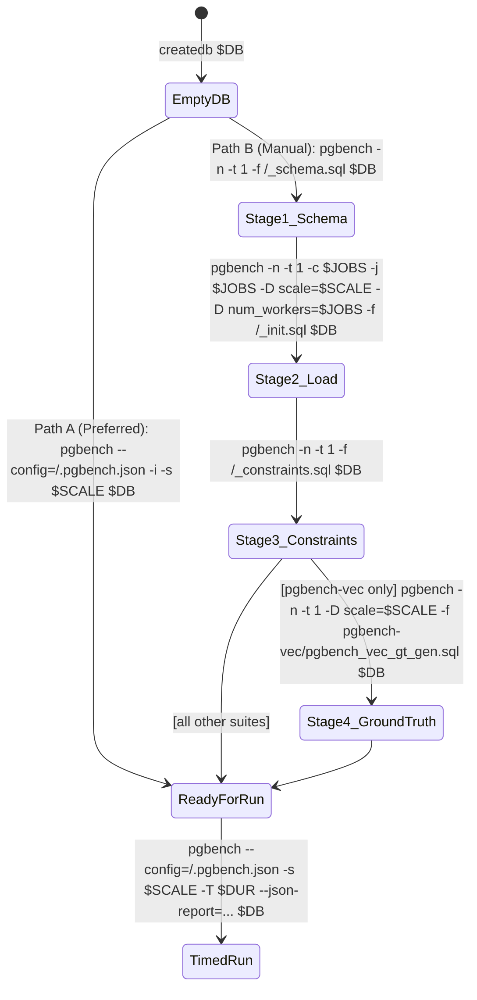

<!--
  INSPIRATION & TRADEMARK DISCLAIMER:
  The benchmark workloads in this repository are clean-room, non-comparable engineering workloads
  historically inspired by industry benchmarks (such as TPC-B, TPC-C, TPC-E, TPC-H, TPC-DS,
  CH-benCHmark, LDBC, and VecBench). Those names are mentioned ONLY in this opening header comment
  to acknowledge architectural inspiration. Throughout all file names, titles, documentation,
  configurations, and scripts, always use the clean-room `pgbench-*` workload names.
-->
# Agent-Oriented Guide: Main `pgbench` & `contrib/pgbench` Usage

**Target Audience**: Autonomous AI coding/benchmarking agents (**Jetski**, Google3 `DeepCoder` / `invoke_subagent` subagents, Gemini CLI, Claude Code, Cursor, Codex) and engineers automating PostgreSQL performance testing with **`postsql/pgbench4perffarm`** (`//third_party/pgext/pgbench4perffarm`).  
**Companion Skill**: [`skills/pgbench4perffarm/SKILL.md`](../skills/pgbench4perffarm/SKILL.md) (`~/.gemini/config/skills/pgbench4perffarm/SKILL.md`)  
**Perffarm Companion Guide**: [`doc/agent-guide-perffarm.md`](agent-guide-perffarm.md)  
**Wholesale Order-Entry (`pgbench-order` / `pgbench-c`) Specification & Multi-Dialect / Non-SQL Porting Guide**: [`doc/agent-guide-pgbench-order.md`](agent-guide-pgbench-order.md)

---

## 1. Architecture of Agentic Benchmarking with `pgbench4perffarm`

Human-oriented prose guides require reading thousands of lines across multiple files. For AI agents, `pgbench4perffarm` provides **four machine-first interfaces** that eliminate CLI construction errors and fragile stdout regex parsing:

```
┌────────────────────────────────────────────────────────────────────────────┐
│                   AI Coding / Benchmarking Agent                           │
└──────┬──────────────────────┬───────────────────────┬──────────────────────┘
       │ 1. Declarative Spec  │ 2. Structured Output  │ 3. SQL Telemetry DB
       ▼                      ▼                       ▼
┌─────────────────────┐ ┌────────────────────┐ ┌─────────────────────────────┐
│ --config=<file>.    │ │ --json-report=     │ │ --log-db="dbname=..."       │
│   pgbench.json      │ │   /tmp/run.json    │ │  • pgbench_show_run()       │
│  • init_steps[]     │ │  • configuration{} │ │  • pgbench_compare_runs()   │
│  • reservoirs[]     │ │  • overall{}       │ │  • pgbench_viewer_payload_  │
│  • groups[]         │ │  • groups[]        │ │    json()                   │
│  • sla[]            │ │  • sla_all_passed  │ │  • pgbench_viewer.py        │
└─────────────────────┘ └────────────────────┘ └─────────────────────────────┘
```

1. **Declarative JSON/JSONC Workload Configs (`--config=<file>.pgbench.json`)**: Every built-in suite in `src/bin/pgbench/workloads/<suite>/` ships with ready-to-run `.pgbench.json` manifests encoding `init_steps[]`, `reservoirs[]`, `groups[]`, and `sla[]`.
2. **In-Database Parallel C Generators (`contrib/pgbench`)**: Instead of streaming millions of rows over `libpq` from client scripts, `CREATE EXTENSION pgbench;` exposes 51 C functions in `SCHEMA pgbench` (`pgbench.random()`, `pgbench.nurand()`, `pgbench.c_last()`, `pgbench.permute()`, `pgbench.clustered_vector()`, `pgbench.rmat_edge()`, `pgbench.ldbc_correlated_edge()`, `pgbench.compute_ground_truth()`) sharing `src/common/pgbench_funcs.c` with the client.
3. **Structured JSON Telemetry (`--json-report=<file>`)**: Emits `$.configuration` (directly replayable via `pgbench --config=<report.json>`), `$.overall` (TPS, transaction counts, validation pass rate, HDR latency percentiles, schedule lag, Recall@K), `$.groups[*]`, `$.scripts[*]`, `$.sla_verifications[*]`, and `$.sla_all_passed`.
4. **Self-Bootstrapping SQL Telemetry Store (`--log-db=<conninfo|self>`)**: Automatically provisions 9 tables (`pgbench_runs` + 8 child/stream tables), 2 views (`pgbench_runs_v`, `pgbench_live_progress_v`), and SQL set-returning functions (`pgbench_show_run()`, `pgbench_compare_runs()`) so agents can compare runs with a single SQL query.

---

## 2. Intent-to-Workload Dispatch Matrix

Use this lookup table to map a user's natural-language testing goal directly to the target workload suite, required extensions, and canonical `--config` file (relative to `src/bin/pgbench/workloads/`):

| Testing Objective / Subsystem Under Test | Target Suite | `--config` Manifest(s) | Required Extensions | Default `-s` Scale | Key Telemetry Assertions (`--json-report`) |
| :--- | :--- | :--- | :--- | :--- | :--- |
| **WAL write path, buffer lock contention, checkpoint tuning, stored-proc OLTP** | `pgbench-b` | `pgbench-b/pgbench_b.pgbench.json` | `pgbench` | `-s 10` (`1M` accounts) | `$.overall.tps`, `$.overall.latency_ms.p95` |
| **Multi-table OLTP locking, B-tree split contention, skewed `nurand` access, `\try`/`\catch` 1% expected rollbacks** | `pgbench-c` | `pgbench-c/pgbench_order.pgbench.json` | `pgbench` | `-s 2` (`2` warehouses) | `$.overall.tps`, `$.overall.latency_ms.p95`, `$.overall.transactions_failed == 0` |
| **Complex financial brokerage OLTP (16 tables, 10 stored procs, limit-order rollbacks)** | `pgbench-e` | `pgbench-e/pgbench_e.pgbench.json` | `pgbench` | `-s 1` (`1000` customers) | `$.overall.tps`, `$.overall.latency_ms.p95` |
| **Parallel hash joins, sort/aggregation `work_mem` spills, vectorized scan throughput (`Q1`–`Q19` + throttled `RF1`/`RF2` refresh)** | `pgbench-h` | `pgbench-h/pgbench_h.pgbench.json` | `pgbench` | `-s 1` | `$.overall.tps`, `$.groups[*].latency_ms.p95` |
| **Star-schema query optimizer join ordering (13 tables, CTEs, window functions + concurrent maintenance)** | `pgbench-ds` | `pgbench-ds/pgbench_ds.pgbench.json` | `pgbench` | `-s 1` | `$.groups[*].tps`, `$.groups[*].latency_ms.p95` |
| **HTAP workload isolation (concurrent `oltp` writers + `olap` readers with independent SLAs)** | `pgbench-htap` | `pgbench-htap/pgbench_htap.pgbench.json` | `pgbench` | `-s 2` | `$.groups[?(@.name=='oltp')].latency_ms.p95`, `$.groups[?(@.name=='olap')].latency_ms.p95`, `$.sla_all_passed == true` |
| **Variable-length graph traversal (`LSQB`, `SNB Interactive`, `SNB BI`, `FinBench`, `Graphalytics`) across `SQL`, `SQL_UD`, ISO `SQL/PGQ`, and `plPGQ`** | `pgbench-graph`<br>`pgbench-graph-sql-ud`<br>`pgbench-graph-pgq`<br>`pgbench-graph-plpgq` | `lsqb.pgbench.json`<br>`snb_interactive.pgbench.json`<br>`snb_bi.pgbench.json`<br>`finbench.pgbench.json`<br>`graphalytics.pgbench.json` | `pgbench` *(+ `plv8`/`pljs` for `plpgq`)* | `-s 1` | `$.overall.validation_failed == 0`, `$.overall.latency_ms.p95` |
| **Vector ANN & hybrid search (Modes 1–5) and continuous churn / Q1-vs-Q4 index aging degradation (Mode 6)** | `pgbench-vec` | `pgbench-vec/vec_hybrid.pgbench.json`<br>`pgbench-vec/vec_aging.pgbench.json` | `pgbench` *(+ optional `vector`)* | `-s 1` | `$.overall.recall.avg_recall >= 0.80`, `$.sla_all_passed == true` |

---

## 3. Formal Initialization State Machine

Agents have two mutually exclusive paths to initialize a benchmark database:



### Critical Initialization Invariants
1. **Path A (`--config=<file>.pgbench.json -i`)** automatically executes every step in the config's `init_steps[]` array in order (`schema` -> parallel `data` -> `constraints` -> optional `ground_truth`).
2. **Path B (Manual `-f <suite>/*_schema.sql`)** MUST use `-n -t 1` (without `-i`).
3. **Parallel Data Loading (`*_init.sql`)**: Every `*_init.sql` script partitions work across `:client_id` and `:num_workers` (`-c 4 -j 4 -t 1 -D scale=$SCALE -D num_workers=4`).
4. **Template Database Cloning**: When running >1 experiment against the same initial dataset, initialize `bench_tpl` once and clone it in `< 0.5s` before each run via `createdb -T bench_tpl bench_run`.

---

## 4. Strict CLI Flag Mutual Exclusions & Runtime Guardrails

Violating any of the following rules causes `pgbench` to exit immediately with a fatal error or hang indefinitely:

| Rule ID | Forbidden Combination / Pattern | Why It Fails | Correct Agent Pattern |
| :--- | :--- | :--- | :--- |
| **`RULE-01`** | `pgbench -i -f pgbench_order_schema.sql` | `-f` sets `benchmarking_option_set = true`, which is rejected in `-i` mode (`pgbench: error: some of the specified options cannot be used in initialization (-i) mode`). | Either use `pgbench --config=pgbench_order.pgbench.json -i` (no `-f`) OR `pgbench -n -t 1 -f pgbench_order_schema.sql` (no `-i`). |
| **`RULE-02`** | `pgbench --config=htap.pgbench.json -f extra.sql` or `pgbench --group="name=g1,..." --group="name=g2,..." -c 8` | Passing `-f`, `-b`, or `--group` after `--config` clears all scripts/groups loaded from `--config` (`clearConfigScriptsAndGroups()`). And when multiple `--group` flags are given on the CLI, top-level `-c`/`-j` are overwritten by the sum of each group's `clients`/`threads`. *(Note: `-c N -j M` **can** be combined with `--config` to proportionally scale configured groups.)* | Either use `--config=<file>.pgbench.json [-c N -j M]` to scale configured groups, OR declare `name=...,clients=N,threads=M,file=path@weight` inside each CLI `--group="..."` flag. |
| **`RULE-03`** | `pgbench --config=snb_bi.pgbench.json -T 30` | `\phase_barrier` waits for all `N` clients to reach the barrier. With timer mode (`-T`), some clients finish when the timer expires while others block at `\phase_barrier`. | Always use bounded transaction count `-t <N>` (e.g., `-t 3`) when running scripts containing `\phase_barrier`. |
| **`RULE-04`** | Using `\reservoir_pop` in custom `.sql` scripts | The meta-command name in `commands.c` is `\reservoir_sample`. | Use `\reservoir_sample <res_name> <var_name> [<default_expr>]` and pass `--reservoir=<res_name>:<capacity>` on the CLI. |
| **`RULE-05`** | Using `==` in `\if` / `\while` conditions | `exprparse.y` uses SQL equality (`=`) and inequality (`<>` or `!=`). | Write `\if :scale = 1` (never `\if :scale == 1`). |

---

## 5. Exit Code (`0` / `1` / `2`) Semantics & Triage Decision Tree

In `src/bin/pgbench/pgbench.c`, `pgbench` returns three distinct exit codes:

```
pgbench exit code
 ├── 0 ──► Run succeeded AND all --sla rules passed ($.sla_all_passed == true)
 ├── 1 ──► Does --json-report file exist and parse as valid JSON?
 │          ├── YES (and $.sla_all_passed == false)
 │          │    └──► WORKLOAD COMPLETED NORMALLY, but >=1 --sla rule failed!
 │          │         Inspect $.sla_verifications[*] for the breached metric & threshold.
 │          └── NO
 │               └──► FATAL PRE-FLIGHT / CONNECTION / SYNTAX ERROR (pg_fatal).
 │                    Inspect stderr against the Error Triage Table.
 └── 2 ──► CLIENT ABORTED MID-RUN (state != CSTATE_FINISHED).
            Inspect stderr and postgres.log for unhandled SQL errors or backend crashes.
```

---

## 6. Post-Flight Telemetry Inspection (`--json-report`, `--log-db` & `pgbench_viewer.py`)

### 6.1 Inspecting `--json-report` via Python One-Liner
```bash
python3 - <<'PY' /tmp/pgbench_c.json
import json, sys
r = json.load(open(sys.argv[1]))
ov = r.get("overall", {})
lat = ov.get("latency_ms", {})
print(f"Total Tx / TPS:   {ov.get('transactions_processed')} tx (failed={ov.get('transactions_failed')}, expected_rb={ov.get('expected_rollbacks')}) | {ov.get('tps', 0):.2f} TPS")
print(f"Latency (ms):     avg={lat.get('avg', 0):.2f} p50={lat.get('p50', 0):.2f} p95={lat.get('p95', 0):.2f} p99={lat.get('p99', 0):.2f}")
print(f"SLA All Passed:   {r.get('sla_all_passed')}")
for g in r.get("groups", []):
    gl = g.get("latency_ms", {})
    print(f"  Group {g['name']:10s}: {g.get('tps', 0):.2f} TPS | p95={gl.get('p95', 0):.2f} ms | p99={gl.get('p99', 0):.2f} ms")
for s in r.get("sla_verifications", []):
    if not s.get("passed", True):
        print(f"  [SLA BREACH] {s}")
PY
```

### 6.2 Querying `--log-db` via SQL Set-Returning Functions (`metrics_db_schema.sql`)
When `--log-db="dbname=perffarm_metrics"` (or `--log-db=self`) is passed, `pgbench` logs the run into `pgbench_runs` and its 8 child/stream tables (`pgbench_run_groups`, `pgbench_run_scripts`, `pgbench_run_commands`, `pgbench_run_recalls`, `pgbench_run_slas`, `pgbench_progress_log`, `pgbench_agg_log`, `pgbench_tx_log`):

```sql
-- 1. Show full 7-section vertical scorecard for the latest run (or pass a specific run_id or run_label)
-- Returns: (section, scope, metric, value, unit, details)
SELECT * FROM pgbench_show_run();
SELECT * FROM pgbench_show_run('my_run_label');

-- 2. Compare two runs by run_id or run_label
-- Returns: (scope, metric, unit, base_val, cand_val, abs_delta, pct_change, verdict)
SELECT * FROM pgbench_compare_runs('baseline_v1', 'candidate_v2');
SELECT * FROM pgbench_compare_runs(1, 2);

-- 3. Compare N runs simultaneously against the first element as baseline
-- Returns: (scope, metric, unit, run_id, run_label, val, delta_vs_base, pct_vs_base, sla_all_passed)
SELECT * FROM pgbench_compare_runs(ARRAY[1, 2, 3, 4]::bigint[]);
```

### 6.3 Launching the Zero-Dependency WebAssembly Telemetry Viewer (`pgbench_viewer.py`)
`src/bin/pgbench/viewer/pgbench_viewer.py` uses embedded `bottle.py`, `Water.css`, and a 439-byte WebAssembly charting kernel (`wasm/pgbench_chart.wasm`):
```bash
python3 src/bin/pgbench/viewer/pgbench_viewer.py --log-db="dbname=perffarm_metrics" --port=8094
```

---

## 7. Copy-Pasteable Subagent Prompt Templates (`DeepCoder` / `invoke_subagent`)

### Template 1: A/B GUC or Patch Evaluation on `pgbench-c` / `pgbench-htap`
> **Task**: Evaluate the performance impact of `<GUC_OR_PATCH>` on PostgreSQL using `pgbench4perffarm` (`pgbench-c` and `pgbench-htap`).  
> **Instructions**:  
> 1. Read `AGENTS.md`, `~/.gemini/config/skills/pgbench4perffarm/SKILL.md`, and `doc/agent-guide-pgbench.md` first. Never run `find` or `grep` inside `google3/` (use `code_search`), and write all runtime databases/reports to `/tmp` or `/var/tmp` (never into CitC).  
> 2. Build and install `pgbench4perffarm` against `PG_CONFIG=<path>` (e.g. `/usr/local/google/home/hannuk/pg20_install/bin/pg_config` or via `/google/bin/releases/arca9-local-blaze-cli/blaze-for-agents`).  
> 3. Initialize golden template databases `tpl_c` (`pgbench_order.pgbench.json -i -s 2`) and `tpl_htap` (`pgbench_htap.pgbench.json -i -s 2`).  
> 4. For both `baseline` and `candidate`, clone from the template database (`createdb -T ...`), run a `30s` timed benchmark (`-T 30`) logging to `--json-report` and `--log-db="dbname=perffarm_metrics"`, and verify the server log has zero leak warnings or errors.  
> 5. Query `SELECT * FROM pgbench_compare_runs('baseline_c', 'candidate_c');` and `SELECT * FROM pgbench_compare_runs('baseline_htap', 'candidate_htap');` and report TPS and P50/P95/P99 latency deltas.

### Template 2: Graph Engine Comparison (`SQL` vs `SQL_UD` vs `SQL/PGQ`)
> **Task**: Compare graph query performance across the `pgbench-graph`, `pgbench-graph-sql-ud`, and `pgbench-graph-pgq` suites in `pgbench4perffarm`.  
> **Instructions**:  
> 1. Read `AGENTS.md`, `~/.gemini/config/skills/pgbench4perffarm/SKILL.md`, and `doc/agent-guide-pgbench.md`.  
> 2. Initialize each graph template DB (`lsqb.pgbench.json -i -s 1`) and run bounded transaction runs (`-t 5`) for `lsqb.pgbench.json`, `snb_interactive.pgbench.json`, and `snb_bi.pgbench.json` across `workloads/pgbench-graph/`, `workloads/pgbench-graph-sql-ud/`, and `workloads/pgbench-graph-pgq/`, logging all runs to `--log-db="dbname=perffarm_metrics"`.  
> 3. Compare all runs via `SELECT * FROM pgbench_compare_runs(ARRAY[1,2,3]::bigint[]);`.

### Template 3: Re-Creating `pgbench-order` (`pgbench-c`) for a New SQL Dialect or Non-SQL Query Language
> **Task**: Re-create the wholesale order-entry OLTP workload (`pgbench-order` / `pgbench-c`) for `<TARGET_SQL_DIALECT_OR_NON_SQL_LANGUAGE>`.  
> **Instructions**:  
> 1. Read `doc/agent-guide-pgbench-order.md` and `skills/pgbench4perffarm/references/pgbench_order_workflow_and_porting_spec.md` for the exact 9-entity schema, `nurand`/`c_last`/`permute` formulas, all 5 transaction specifications (`New-Order`, `Payment`, `Order-Status`, `Delivery`, `Stock-Level`), `Model A` server-side `PL/pgSQL` stored procedures vs. `Model B` pure client-driven SQL DML templates, non-SQL Cypher/Document/KV mappings, and the 8 post-run consistency invariants (`verify_pgbench_order_invariants.sql`).  
> 2. Implement the schema, initial loader, 5 weighted transaction scripts (`45:43:4:4:4`), and `.pgbench.json` manifest, then verify at `-s 2` that all 8 `\validate_result` invariants pass with zero unexpected failed transactions.
