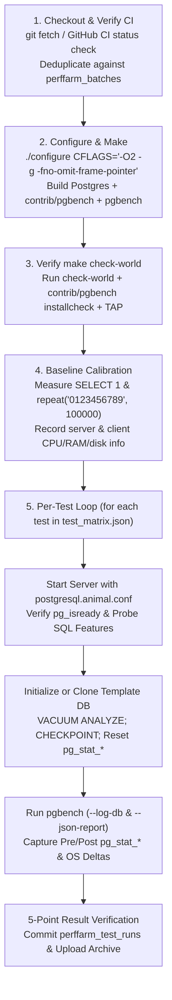

# Perffarm Animal Setup & Continuous Benchmarking Guide (`perffarm/`)

This guide explains how to set up and operate a PostgreSQL Performance Farm ("perffarm") animal using **`pgbench4perffarm`** (`perffarm/`).

The `perffarm/` harness provides a self-contained, configuration-driven workflow covering:
1. **One-Time Animal Setup**:
   - Server build configuration flags and options (`CFLAGS`, `CONFIGURE_FLAGS`, `PGXS` extension/client build).
   - Deterministic server runtime configuration (`postgresql.animal.conf` generated from hardware discovery or preset tiers `small-dev`, `medium-vm`, `large-baremetal`).
   - Machine definition, OS tuning, and per-instance hardware/disk auto-discovery across **local or external/Cloud VM topologies** (recording CPU count, RAM size, and separate disk profiles for **system `/`**, **data `PGDATA_DIR`**, and **WAL `PGWAL_DIR`** disks).
   - Persistent Metrics Database provisioning and schema (`setup_metrics_db.sh` + `sql/metrics_db_schema.sql`).
   - Configuring the test matrix (`conf/test_matrix.json`), telemetry granularity (`summary`, `timeseries`, `full-trace`), and upload targets.
2. **Regular Perffarm Runs (`run_perffarm.sh`)**:
   - Checking out the latest PostgreSQL code and verifying upstream CI status.
   - Running `./configure` + `make` and verifying `make check-world` + `pgbench4perffarm` regression/TAP suites.
   - Measuring client-to-server baseline round-trip latency (`SELECT 1;`) and 1 MB payload throughput (`SELECT repeat('0123456789', 100000);`).
   - Executing each selected test against a clean PostgreSQL server instance with pre/post `pg_stat_*` and OS `/proc` delta collection, 5-point result verification, and immediate Metrics DB + archive upload.

---

## 1. Architecture & Deployment Topologies

### 1.1 Supported Topologies (Local vs. External / Cloud VMs)

Both the PostgreSQL server under test and the `pgbench` client driver can run on the local machine or on newly provisioned external machines / Cloud VMs:

| `TOPOLOGY` Value | PostgreSQL Server Instance | `pgbench` Client Instance | Description |
| :--- | :--- | :--- | :--- |
| **`local`** *(default)* | Local machine (`127.0.0.1`) | Local machine (`127.0.0.1`) | All-in-one local execution on bare-metal hardware or a single VM. |
| **`remote-server`** | External host / Cloud VM (`SERVER_SSH_TARGET`) | Local machine | Local `pgbench` client drives a remote PostgreSQL server instance. |
| **`remote-client`** | Local machine | External host / Cloud VM (`CLIENT_SSH_TARGET`) | Remote `pgbench` client drives a local PostgreSQL server instance. |
| **`both-remote`** | External host / Cloud VM A (`SERVER_SSH_TARGET`) | External host / Cloud VM B (`CLIENT_SSH_TARGET`) | Server and client run on separate (or co-located) external Cloud VMs. |

When `CLOUD_PROVIDER` is configured (`gcp`, `aws`, `ssh`, or `custom` via `PROVISION_CMD` / `TEARDOWN_CMD` in `animal.conf`), `perffarm/provision_hosts.sh` can automatically provision new Cloud VMs at the start of a batch (`AUTO_PROVISION=true`), attach dedicated data and WAL SSD/NVMe volumes, sync `pgbench4perffarm`, and tear the VMs down upon completion (`AUTO_TEARDOWN=true`).

### 1.2 Per-Instance Hardware & Disk Inventory (`collect_instance_info.py`)

For every participating instance (`server_instance_info` and `client_instance_info` stored in `perffarm_animals` and `perffarm_batches`), `perffarm/collect_instance_info.py` records:

- **CPU Metrics**:
  - `cpu_count` (`logical_cpus`), `physical_cores`, `sockets`, `threads_per_core`, `numa_nodes`, `model_name`, `architecture`, `freq_mhz_current`, `freq_mhz_max`, `scaling_governor`, and `l3_cache`.
- **Memory Metrics**:
  - `ram_total_bytes`, `ram_total_gb`, `ram_available_bytes`, `swap_total_bytes`, `hugepages_total`, `hugepages_free`, `hugepage_size_kb`, and `transparent_hugepage` mode.
- **Per-Disk Storage Metrics (Separately for System, Data, and WAL Disks)**:
  - `disks.system_disk` (for `/`)
  - `disks.data_disk` (for `PGDATA_DIR`)
  - `disks.wal_disk` (for `PGWAL_DIR`)
  - Boolean flags `dedicated_data_disk` (whether `data_disk` is on a separate mount/device from `system_disk`) and `dedicated_wal_disk` (whether `wal_disk` is on a separate mount/device from `data_disk`).
  - Each disk object captures `mount_point`, `filesystem_type`, `mount_options`, `block_device`, `parent_disk`, `total_bytes` (`total_gb`), `avail_bytes` (`avail_gb`), `rotational`, `media_type` (`NVMe`, `SSD`, `HDD`, `tmpfs/ramdisk`, `network/virtual`), `device_model`, `io_scheduler`, and optional `seq_write_mbps_probe` (16 MB sequential write + `fsync` micro-probe).

### 1.3 Client-Server Baseline Latency & Throughput Calibration (`calibrate_baseline.py`)

Before running the benchmark suite (and recorded in `perffarm_batches.baseline_calibration`, `perffarm_test_runs.baseline_calibration`, and `baseline_calibration.json`), `perffarm/calibrate_baseline.py` runs two calibration probes from the `pgbench` client instance to the PostgreSQL server instance:

1. **`SELECT 1;` (Client-Server Round-Trip Latency & QPS)**:
   - Executes warmup queries followed by timed single-client round-trip iterations (default `200`) using `pgbench` HDR microsecond histograms.
   - Records `latency_avg_ms`, `latency_min_ms`, `latency_p50_ms`, `latency_p90_ms`, `latency_p95_ms`, `latency_p99_ms`, `latency_max_ms`, `latency_avg_us`, `latency_p50_us`, `latency_p95_us`, and `qps`.
2. **`SELECT repeat('0123456789', 100000);` (1 MB Payload Transfer Throughput)**:
   - Each query generates and transfers `1,000,000` bytes (`100,000` repeats of the 10-byte string `'0123456789'`, i.e., `1.0 MB` decimal) from the PostgreSQL server to the client.
   - Executes timed iterations (default `50` iterations = `50 MB` transferred) and records `latency_avg_ms`, `latency_p50_ms`, `latency_p95_ms`, `latency_p99_ms`, `rows_per_sec`, `throughput_mb_per_sec` (MB/s), `throughput_mib_per_sec` (MiB/s), and `throughput_gbps` (Gbps).

---

## 2. One-Time Animal Setup

### 2.1 Server Build Configuration Flags & Options

In `perffarm/conf/animal.conf`:

```bash
PG_GIT_URL="https://github.com/postgres/postgres.git"
PG_BRANCHES="master"
CC="gcc"
CFLAGS="-O2 -g -fno-omit-frame-pointer"
CONFIGURE_FLAGS="--without-icu"
AUTO_DETECT_LIBS="true"
```

- **Release Compiler Flags**: Always benchmark with `-O2 -g -fno-omit-frame-pointer` and **never** pass `--enable-cassert` (assertion builds add 20–50% CPU overhead in memory context validation and tuple checks).
- **Library Auto-Detection**: When `AUTO_DETECT_LIBS="true"`, `setup_machine.sh` inspects `pkg-config` and automatically appends `--with-ssl=openssl`, `--with-lz4`, `--with-zstd`, and `--with-libxml` if development headers are installed.
- **Cross-Installing `pgbench4perffarm`**: After building the target PostgreSQL server (or when pointing `PREBUILT_PG_CONFIG` at an existing installation), `run_perffarm.sh` compiles and installs both `contrib/pgbench` (`pgbench.so` + `pgbench--1.0.sql`) and `src/bin/pgbench` (`pgbench`) via `USE_PGXS=1`.

### 2.2 Server Runtime Configuration (`generate_pgconf.py`)

`perffarm/generate_pgconf.py` combines `perffarm/conf/postgresql.perffarm.conf.in` with `hardware_profile.json` to write a frozen, deterministic `postgresql.animal.conf`:

| Sizing Preset (`PG_SIZING_PRESET`) | `shared_buffers` | `effective_cache_size` | `maintenance_work_mem` | `work_mem` | `min_wal_size` / `max_wal_size` |
| :--- | :---: | :---: | :---: | :---: | :---: |
| **`auto`** *(default)* | 25% of RAM (up to 32 GB) | 75% of RAM | 6.25% of RAM (up to 2 GB) | Scaled by RAM / `max_connections` | `256MB`..`2GB` / `1GB`..`8GB` (by disk space) |
| **`small-dev`** | `1GB` | `4GB` | `256MB` | `16MB` | `512MB` / `2GB` |
| **`medium-vm`** | `8GB` | `24GB` | `1GB` | `32MB` | `2GB` / `8GB` |
| **`large-baremetal`** | `32GB` | `96GB` | `2GB` | `64MB` | `4GB` / `16GB` |

Observability GUCs enabled by default in `postgresql.animal.conf`:
- `track_io_timing = on`
- `track_wal_io_timing = on` (automatically omitted on PostgreSQL 14)
- `track_functions = all`
- `shared_preload_libraries = 'pg_stat_statements'` (`pg_stat_statements.track = all`)
- `log_checkpoints = on`, `log_lock_waits = on`, `log_temp_files = 0`, `log_autovacuum_min_duration = 1000`

### 2.3 Machine Setup Script (`setup_machine.sh`)

```bash
# 1. Create animal.conf from template and run unprivileged preflight + discovery:
./perffarm/setup_machine.sh --init-config

# 2. Optional: install apt/dnf packages and apply Linux kernel / CPU governor tuning:
./perffarm/setup_machine.sh --install-deps --tune-os
```

`setup_machine.sh` writes four state artifacts into `$WORKDIR/state/`:
- `server_instance_info.json` — Server CPU, RAM, and separate system/data/WAL disk telemetry.
- `client_instance_info.json` — Client CPU, RAM, and disk telemetry.
- `hardware_profile.json` — Combined topology and instance profile.
- `postgresql.animal.conf` — Deterministic PostgreSQL server configuration.

### 2.4 Metrics Database Setup (`setup_metrics_db.sh` & `sql/metrics_db_schema.sql`)

```bash
# Provision and start the local persistent Metrics DB cluster (default port 55433)
# and register the animal in perffarm_animals:
./perffarm/setup_metrics_db.sh --config=perffarm/conf/animal.conf --ensure
```

The Metrics Database combines:
1. **All 9 `pgbench --log-db` tables and views**:
   - Tier A (`LOGGED`): `pgbench_runs`, `pgbench_run_groups`, `pgbench_run_scripts`, `pgbench_run_commands`, `pgbench_run_recalls`, `pgbench_run_slas`
   - Tier B/C (`UNLOGGED` by default): `pgbench_progress_log`, `pgbench_agg_log`, `pgbench_tx_log`
   - Views & SRFs: `pgbench_runs_v`, `pgbench_live_progress_v`, `pgbench_show_run()`, `pgbench_compare_runs()`
2. **Perffarm Catalog Tables**:
   - `perffarm_animals`: Stores `animal_name`, `owner`, `topology`, `hardware_profile`, `server_instance_info`, `client_instance_info`, `os_info`, and `pg_conf_snapshot`.
   - `perffarm_batches`: Stores `batch_id`, `animal_name`, `topology`, `test_profile`, `metrics_level`, `pg_branch`, `pg_version_num`, `git_commit_sha`, `git_commit_ts`, `git_commit_subject`, `ci_status`, `configure_flags`, `cflags`, `build_status`, `build_duration_sec`, `check_world_status`, `check_world_duration_sec`, `server_instance_info`, `client_instance_info`, `baseline_calibration`, and pass/fail/skip counts.
   - `perffarm_test_runs`: Stores `test_run_id`, `batch_id`, `test_name`, `suite_name`, `pgbench_run_id` (foreign key to `pgbench_runs`), `scale`, `clients`, `threads`, `duration_sec`, `init_duration_sec`, `template_reused`, `db_size_bytes`, `server_settings`, `baseline_calibration`, `pg_stat_database_delta`, `pg_stat_bgwriter_delta`, `pg_stat_checkpointer_delta`, `pg_stat_wal_delta`, `pg_stat_io_delta`, `pg_stat_statements_top`, `os_metrics`, `client_os_metrics`, `verification_status`, and `verification_details`.
3. **Longitudinal Regression Views & Functions**:
   - `perffarm_commit_summary_v`: Unified view joining test runs, batches, animals, `pgbench_runs`, instance CPU/RAM/disk info, and `SELECT 1` / `repeat('0123456789', 100000)` baseline calibration metrics.
   - `perffarm_regressions_v`: Windowed commit-over-commit comparison (`LAG()`) flagging `REGRESSED`, `IMPROVED`, `STABLE`, or `FAILED_VERIFICATION`.
   - `perffarm_compare_commits(sha_a, sha_b, animal_name)`: Set-Returning Function comparing two git commit SHAs across all common tests.

### 2.5 Test Set, Telemetry Levels & Upload Configuration (`conf/test_matrix.json`)

`perffarm/conf/test_matrix.json` defines **26 benchmark tests** across **3 sizing profiles** (`smoke`, `standard`, `nightly`):
- **Built-in Baselines**: `tpcb-like`, `select-only`, `simple-update`
- **Relational OLTP**: `pgbench-b`, `pgbench-c`, `pgbench-e`
- **Analytical DSS & HTAP**: `pgbench-h`, `pgbench-ds`, `pgbench-htap`
- **Graph (`SQL`)**: `pgbench-graph-lsqb`, `pgbench-graph-snb-interactive`, `pgbench-graph-snb-bi`, `pgbench-graph-finbench`, `pgbench-graph-graphalytics`
- **Graph (`SQL_UD` — probed via `UNION DISTINCT ON`)**: `pgbench-graph-sql-ud-lsqb`, `pgbench-graph-sql-ud-snb-interactive`, `pgbench-graph-sql-ud-snb-bi`, `pgbench-graph-sql-ud-finbench`, `pgbench-graph-sql-ud-graphalytics`
- **Graph (`PGQ` — probed via `CREATE PROPERTY GRAPH`)**: `pgbench-graph-pgq-lsqb`, `pgbench-graph-pgq-snb-interactive`, `pgbench-graph-pgq-snb-bi`, `pgbench-graph-pgq-finbench`, `pgbench-graph-pgq-graphalytics`
- **Vector Similarity Search (`pgbench-vec`)**: `pgbench-vec-hybrid`, `pgbench-vec-aging`

Telemetry and upload granularity (`METRICS_LEVEL` / `UPLOAD_LEVEL`):
- **`summary`**: Tier A summary tables (`pgbench_runs`, `pgbench_run_groups`, `pgbench_run_scripts`, `pgbench_run_commands`, `pgbench_run_recalls`, `pgbench_run_slas`) + `perffarm_test_runs`.
- **`timeseries`** *(default)*: Tier A + Tier B 1-second progress (`-P 1` -> `pgbench_progress_log`) and 1-second thread interval aggregates (`-l --aggregate-interval=1` -> `pgbench_agg_log`).
- **`full-trace`**: Tier A + Tier B + Tier C per-transaction trace (`-P 1 -l --log-db-index` -> `pgbench_tx_log`).

---

## 3. Regular Perffarm Run Workflow (`run_perffarm.sh`)



### 3.1 Five-Point Test Result Verification (`verify_test_run.py`)

Every test run is verified against 5 criteria before being marked `PASSED`:
1. **`1_exit_code_zero`**: `pgbench` exited with code `0` and produced a valid `--json-report`.
2. **`2_transactions_healthy`**: `transactions > 0` and `failed_transactions == 0` (expected business rollbacks wrapped in `\try`/`\catch` are counted separately in `expected_rollbacks`).
3. **`3_result_validation_100pct`**: `validation_failed == 0` (`100%` pass rate across all `\validate_result` assertions).
4. **`4_sla_compliance`**: `sla_all_passed == true` across all `--sla` latency, error-rate, validation, and `Recall@K` contracts.
5. **`5_server_log_clean`**: Zero `PANIC:`, `TRAP:`, `FailedAssertion`, `Segmentation fault`, or unexpected `FATAL:` lines in the PostgreSQL server log.

### 3.2 Scheduling Automated Runs (`systemd` or `cron`)

To run via `systemd` timer:
```bash
sudo cp perffarm/systemd/pgbench-perffarm.service /etc/systemd/system/pgbench-perffarm@.service
sudo cp perffarm/systemd/pgbench-perffarm.timer /etc/systemd/system/pgbench-perffarm@.timer
sudo systemctl daemon-reload
sudo systemctl enable --now pgbench-perffarm@$(id -un).timer
```

Or via `crontab -e`:
```cron
0 2 * * * /path/to/pgbench4perffarm/perffarm/run_perffarm.sh --config=/path/to/pgbench4perffarm/perffarm/conf/animal.conf >> /var/tmp/pgbench4perffarm_work/logs/cron.log 2>&1
```
